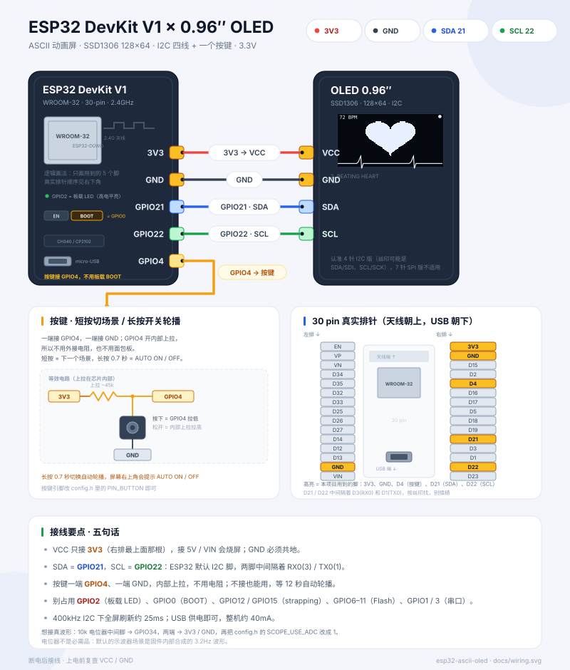
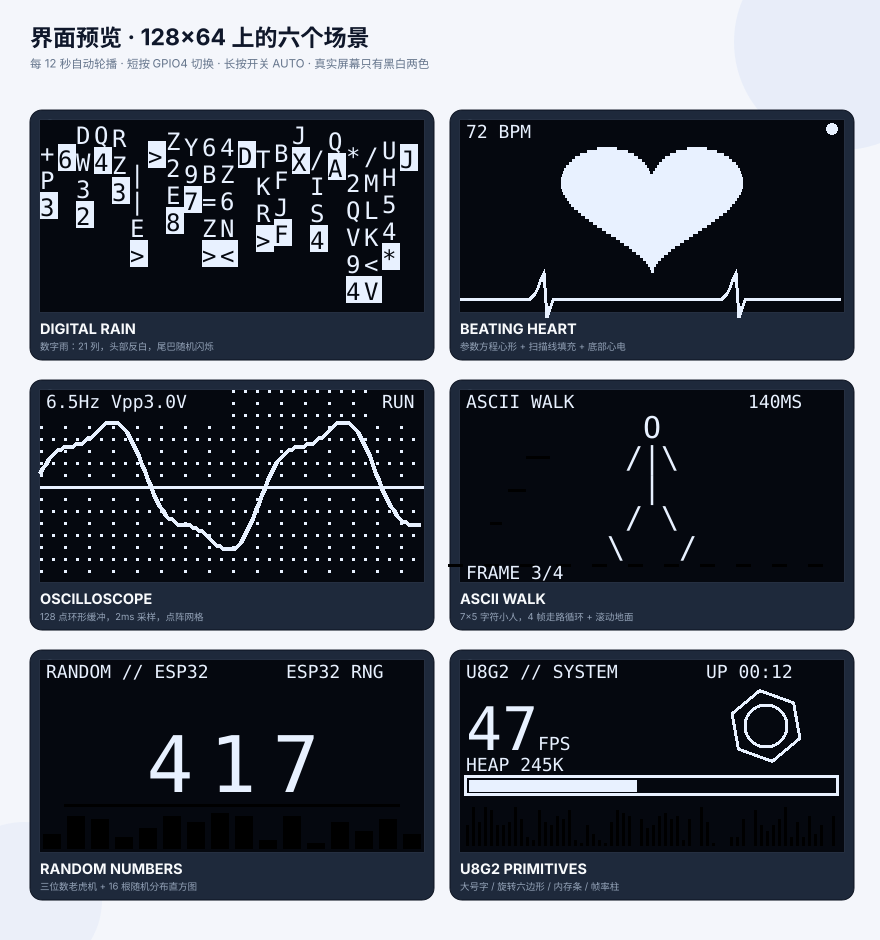

# ESP32 · OLED ASCII 动画屏（DevKit V1 + 0.96″ SSD1306）

一块 **ESP32 DevKit V1** + 一块 **0.96″ OLED（128×64，I2C 四线）**，做一个会自己轮播的
ASCII 动画屏：数字雨、跳动的心、示波器、帧动画、随机数老虎机，外加一屏 U8g2 绘图演示。

整机只用了 **4 根 I2C 线 + 1 个按键**（按键不接也能跑，12 秒自动切场景）。





## 六个场景

| # | 场景 | 用到的技术 | 一眼看懂的实现 |
| --- | --- | --- | --- |
| 1 | `DIGITAL RAIN` | ASCII 字符雨 | 21 列（6×10 等宽字体），每列一个雨滴，头部整格反白，尾巴每帧换字所以会闪 |
| 2 | `BEATING HEART` | 参数方程 + 扫描线填充 | `x=16sin³t`、`y=13cos t−5cos2t−2cos3t−cos4t`，按行求交点再连线填充；底部滚动心电波形 |
| 3 | `OSCILLOSCOPE` | 环形缓冲 + 定点采样 | 128 点缓冲、2ms 采样（500Hz）、点阵网格、自动测 Vpp；默认合成 6.5Hz 波形，也可切真 ADC |
| 4 | `ASCII WALK` | 帧动画 | 7×5 字符小人，4 帧走路循环 + 上下颠 + 滚动地面 |
| 5 | `RANDOM NUMBERS` | 随机数 + 直方图 | 三位数老虎机依次锁死，底部 16 根柱子显示这一轮的分布 |
| 6 | `U8G2 PRIMITIVES` | U8g2 绘图 API | 10×20 大号帧率、旋转六边形、内存条、帧率柱状图 |

**操作**：短按 GPIO4 上的按键 → 下一个场景；长按 0.7 秒 → 开关自动轮播（右上角提示 `AUTO ON / OFF`）。

## 硬件

| 元件 | 说明 |
| --- | --- |
| ESP32 DevKit V1 | WROOM-32，30 pin，micro-USB + CH340 / CP2102 |
| OLED 0.96″ | SSD1306，128×64，**4 针 I2C**（GND / VCC / SCL / SDA） |
| 按键（可选） | 6×6 轻触开关，一端 GPIO4，一端 GND |
| 杜邦线 | 4 根，建议 ≤ 20cm（400kHz I2C 对线长敏感） |

> 7 针 SPI 版 OLED 不适用。买的时候认准 4 针、丝印是 `GND / VCC / SCL / SDA`
> （`SDI` = SDA，`SCK` = SCL）。

## 接线

| OLED | DevKit V1 | 线色 | 说明 |
| --- | --- | --- | --- |
| VCC | **3V3** | 红 | 右排最上面那根；**不要接 5V / VIN** |
| GND | **GND** | 黑 | 右排第二根，必须共地 |
| SDA | **GPIO21** | 蓝 | ESP32 默认 I2C 数据脚 |
| SCL | **GPIO22** | 绿 | ESP32 默认 I2C 时钟脚 |
| 按键一端 | **GPIO4** | 黄 | 内部上拉，不用外接电阻 |
| 按键另一端 | **GND** | 黑 | — |

注意：

- GPIO21 / GPIO22 **不是相邻的两根**，中间隔着 RX0(3) / TX0(1)，按丝印找。
- I2C 地址一般是 `0x3C`，少数模块是 `0x3D`，固件会自动再试一次。
- 别占用 GPIO2（板载 LED）、GPIO0（BOOT）、GPIO12 / GPIO15（strapping）、GPIO6–11（Flash）、GPIO1 / 3（串口）。
- 想接**真实波形**：10k 电位器中间脚 → GPIO34，两端 → 3V3 / GND，再把 `config.h` 里的
  `SCOPE_USE_ADC` 改成 `1`。不接也完全没问题，默认是固件内部合成的波形。

## 快速开始

需要 [PlatformIO](https://platformio.org/)（CLI 或 VSCode 插件都行）：

```bash
cd firmware

pio run                 # 编译
pio run -t upload       # 烧录
pio device monitor      # 串口 115200
```

正常上电的串口大概是这样：

```text
[boot] ESP32 ASCII OLED  SDA=21 SCL=22 BTN=4
[oled] init ok
[scene] 1/6  DIGITAL RAIN
[scene] 2/6  BEATING HEART
[btn] auto advance off
```

> 烧录失败时按住板上的 **BOOT** 再点一下 **EN**，松开后重新 `pio run -t upload`。

## 代码结构

```text
firmware/
  platformio.ini          espressif32 6.13.0 + U8g2
  src/
    config.h              引脚、轮播间隔、示波器开关，全在这里
    scenes.h              Scene 结构体：name + setup + update
    scenes.cpp            六个场景的具体画法
    main.cpp              场景调度、按键消抖、帧率统计、开机动画
tools/
  gen_wiring.py           生成 docs/wiring.svg
  render_screens.py       生成 docs/screens.svg
docs/
  wiring.svg              接线图
  screens.svg             六屏预览
```

一个场景就是一个函数对：

```cpp
struct Scene {
  const char *name;
  void (*setup)(U8G2 &g);
  void (*update)(U8G2 &g, uint32_t now, uint32_t elapsed);
};
```

## 自己加一个场景

1. 在 `scenes.cpp` 里写两个函数：

```cpp
void clockSetup(U8G2 &) {}

void clockUpdate(U8G2 &g, uint32_t now, uint32_t) {
  char buf[16];
  snprintf(buf, sizeof(buf), "%02lu:%02lu",
           (unsigned long)(now / 60000), (unsigned long)((now / 1000) % 60));
  g.setFont(u8g2_font_logisoso24_tn);
  g.drawStr(30, 44, buf);
}
```

2. 加进场景表：

```cpp
const Scene kScenes[] = {
    // ...
    {"CLOCK", clockSetup, clockUpdate},
};
```

`main.cpp` 会自动算好场景数、轮播和按键切换，不用改别的地方。

## 可调参数（`config.h`）

| 宏 | 默认 | 作用 |
| --- | --- | --- |
| `PIN_OLED_SDA` / `PIN_OLED_SCL` | 21 / 22 | I2C 引脚 |
| `OLED_BUS_HZ` | 400000 | I2C 时钟；线长超过 20cm 可以降到 100000 |
| `PIN_BUTTON` | 4 | 按键引脚（低电平有效，内部上拉） |
| `BTN_LONGPRESS_MS` | 700 | 长按判定时间 |
| `SCENE_AUTO_ADVANCE_MS` | 12000 | 自动轮播间隔 |
| `FRAME_MS` | 16 | 主循环最小帧间隔，约 60fps 上限 |
| `SCOPE_USE_ADC` | 0 | 1 = 示波器读 GPIO34 的真实电压 |
| `RAIN_STEP_MS` | 40 | 数字雨下落速度，越小越快 |

## 常见问题

**屏幕全黑，串口打印 `init failed`**
先查 VCC 是不是接的 3V3（接 5V 可能已经烧了），再查 SDA/SCL 有没有接反。
有些模块地址是 `0x3D`，固件会自动重试；还不行就用 I2C 扫描示例确认地址。

**画面有雪花 / 偶尔花屏**
400kHz 下杜邦线太长会这样。把 `OLED_BUS_HZ` 降到 `100000`，或者换短一点的线。

**按键没反应**
按键要一端 GPIO4、一端 GND（不是 3V3）。不接按键也能用：等 12 秒自动切。

**刷新率多少？**
128×64 全屏缓冲 + 400kHz I2C，`sendBuffer()` 一次约 25ms，实测 35–45fps；
HUD 场景右上角会显示实时帧率。

**能显示中文吗？**
可以，但要换 U8g2 的中文字库（比如 `u8g2_font_wqy12_t_gb2312`），
本项目为了保持“ASCII 屏”的调性只用了 ASCII 字体。
