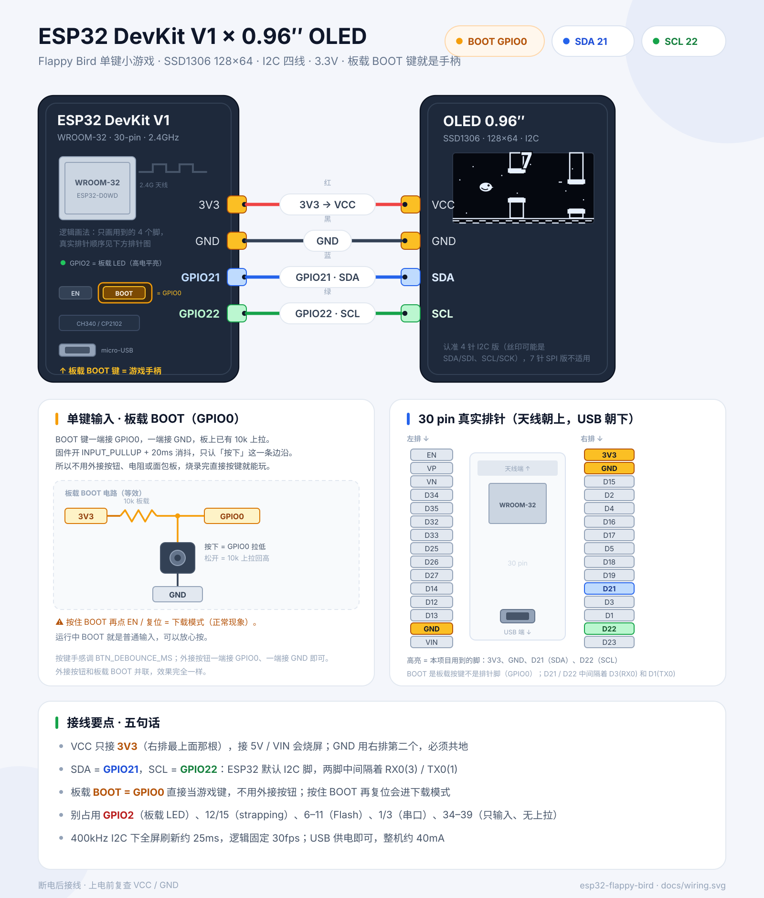
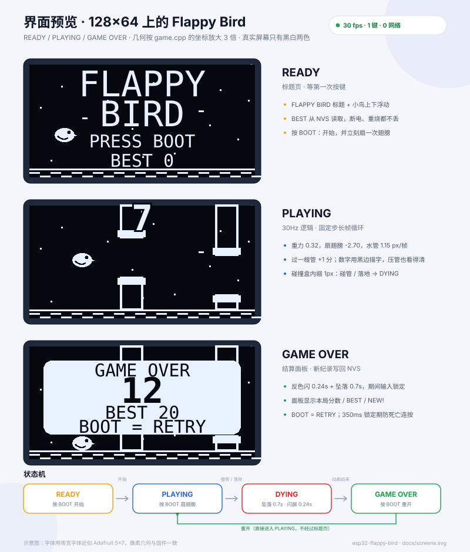

# ESP32 · OLED Flappy Bird（单键 / 状态机 / 帧循环）

一块 **ESP32 DevKit V1** + 一块 **0.96″ SSD1306 OLED（128×64，I2C）**，只用板载 **BOOT 键** 就能玩的 Flappy Bird。

没有 WiFi、没有陀螺仪、没有第二个按钮：一个按键同时负责「开始 / 扇翅膀 / 重开」，剩下的交给状态机和固定步长帧循环。





## 为什么只要 4 根线

DevKit V1 的 **BOOT 键本来就是 GPIO0 对 GND 的轻触开关**，板上还带了 10k 上拉。固件把它当普通输入用：

```c
pinMode(0, INPUT_PULLUP);   // 按下 = LOW
```

所以接线只需要 OLED 的 4 根线，**不用外接按钮、电阻或面包板**。烧录完直接按 BOOT 就能玩。

> 唯一要注意的：**按住 BOOT 再点 EN / 复位** 会让芯片进入下载模式，这是 ESP32 的设计，不是 bug。正常运行时 BOOT 就是普通输入键。

## 硬件

| 元件 | 说明 |
| --- | --- |
| ESP32 DevKit V1 | WROOM-32，30 pin，micro-USB + CH340 / CP2102 |
| OLED 0.96″ | SSD1306，128×64，**4 针 I2C 版** |
| 杜邦线 | 4 根，建议 ≤ 20cm（400kHz I2C 对线长敏感） |
| USB 线 | 能传数据的那种；很多线只能充电 |

> 7 针 SPI 版 OLED 不适用。买的时候认准 4 针、丝印是 `GND / VCC / SCL / SDA`（`SDI` = SDA，`SCK` = SCL）。

## 接线

| OLED | ESP32 DevKit V1 | 线色 | 说明 |
| --- | --- | --- | --- |
| VCC | **3V3** | 红 | 右排最上面那根；**不要接 5V / VIN** |
| GND | **GND** | 黑 | 右排第二根，必须共地 |
| SDA | **GPIO21** | 蓝 | ESP32 默认 I2C 数据 |
| SCL | **GPIO22** | 绿 | ESP32 默认 I2C 时钟 |
| — | **BOOT（GPIO0）** | — | 板载按键，不用接线 |

> DevKit V1 上 GPIO21 和 GPIO22 **不是相邻的两根**，中间隔着 RX0(3) / TX0(1)，按丝印找。
> OLED 地址一般是 `0x3C`，少数模块是 `0x3D`；固件会两个都试，串口会打印实际地址。

## 快速开始

需要 [PlatformIO](https://platformio.org/)（CLI 或 VSCode 插件都行）：

```bash
cd firmware
pio run                 # 编译
pio run -t upload       # 烧录
pio device monitor      # 串口 115200
```

正常上电的串口大概是这样：

```text
[boot] ESP32 Flappy Bird  SDA=21 SCL=22 BTN=0 (30Hz)
[oled] 0x3C ok
[game] ready  best=0
[game] ready -> playing
[game] start  score=0 best=0
[game] crash  score=7 best=7
[game] playing -> dying
[game] dying -> gameover
[game] gameover -> playing
[game] start  score=0 best=7
```

VSCode 里也可以直接打开 `firmware/`，点底部状态栏的 **Upload** 和 **Monitor**。

## 怎么玩

| 当前状态 | 按一下 BOOT | 屏幕 |
| --- | --- | --- |
| READY | 开始，并立刻扇一次翅膀 | `FLAPPY BIRD` / `PRESS BOOT` / `BEST N` |
| PLAYING | 扇翅膀（给一个向上的速度） | 小鸟、水管、顶部实时分数 |
| DYING | 不响应（防止乱按影响动画） | 反色闪两下 + 小鸟坠落 |
| GAME OVER | 重开（直接进入 PLAYING） | 本局分数 / `BEST N` / `BOOT = RETRY` |

规则很简单：

- 穿过一根水管 **+1 分**。
- 碰到水管或落到地面就结束。
- 最高分存在 NVS 里，断电、重新烧录都不丢（`pio run -t erase` 才会清空）。
- 结算后 350ms 内不接受重开，避免“死亡那一下”被连按成重开。

## 状态机

```text
                按 BOOT
       READY ───────────▶ PLAYING
                              │
                              ├── 按 BOOT：扇翅膀（状态不变）
                              │
                          撞管 / 落地
                              ▼
                            DYING
                              │ 0.7s 坠落（前 240ms 反色闪屏）
                              ▼
                          GAME OVER
                              │
                              └── 按 BOOT：直接重开（回到 PLAYING）
```

代码里就四个枚举，所有输入和物理都只改状态，不藏隐式分支：

```cpp
enum class State : uint8_t { Ready, Playing, Dying, GameOver };
```

- **READY**：只做动画和等待，不跑物理。
- **PLAYING**：重力 / 速度 / 水管 / 碰撞 / 计分。
- **DYING**：输入锁定，只让小鸟继续下落，播完 0.7s 进结算。
- **GAME OVER**：冻结世界，显示面板，等重开。

## 帧循环

逻辑固定 **30Hz**，渲染跟着逻辑帧走：

```cpp
const uint32_t now = millis();
uint32_t elapsed = now - prevMs;   // 实际过去了多久
prevMs = now;
if (elapsed > 250) elapsed = 250;  // 烧录/串口卡顿后别一次补几百帧

if (button.pressed(now)) game::onPress(now);

accumulator += elapsed;
while (accumulator >= TICK_MS) {   // TICK_MS = 33
  accumulator -= TICK_MS;
  game::step(now);                 // 物理只在这里推进
  stepped = true;
}

if (stepped) {
  game::render(display, now);      // 只改显存
  display.display();               // 真正推 I2C，约 25ms
}
```

为什么要固定步长：

- 物理参数（重力 `0.32 px/帧²`、扇翅膀 `-2.70 px/帧`）都是按 30Hz 调的；如果用 `millis()` 直接乘时间，掉一帧手感就变了。
- I2C 刷新时间会波动，固定步长 + 累积器可以把「逻辑速度」和「屏幕刷新速度」解耦。
- 累积器上限 250ms：串口打印、烧录或调试暂停后不会突然“快进”几百帧直接撞死。

**性能预算**（400kHz I2C）：

| 项目 | 时间 |
| --- | --- |
| 一帧显存 | 128 × 64 / 8 = 1024 字节 |
| I2C 传输（约 9 bit/字节） | ≈ 23ms |
| `display.display()` 实测 | ≈ 25–30ms |
| 逻辑一帧 | 33ms |

所以这块屏 + 这条总线的舒适上限就是 **30fps**。想更流畅只能减少刷新面积（局部刷新）或换 SPI 屏，单纯把 `TICK_MS` 调小没有意义。

## 可调参数

都在 `firmware/src/config.h`：

| 宏 | 默认 | 作用 |
| --- | --- | --- |
| `TICK_MS` | 33 | 逻辑帧长（30Hz） |
| `GRAVITY` | 0.32 | 每帧重力加速度（px/帧²） |
| `FLAP_VY` | -2.70 | 按一下的瞬时上升速度（px/帧） |
| `VY_MAX` | 4.20 | 下落终端速度 |
| `PIPE_SPEED` | 1.15 | 水管左移速度（px/帧，约 34.5 px/s） |
| `PIPE_GAP` | 23 | 上下管之间的空隙（px） |
| `PIPE_SPACING` | 54 | 相邻水管的水平间距 |
| `PIPE_MIN_GAP_Y` | 18 | 缺口上沿最小 y（顶部水管最短 18px） |
| `PIPE_MAX_GAP_Y` | 30 | 缺口上沿最大 y（底部水管最短 6px） |
| `PIPE_GAP_JITTER` | 6 | 相邻两根管缺口的高度差上限 |
| `BIRD_HIT_INSET` | 1 | 碰撞盒向内缩的像素，越大越宽容 |
| `BTN_DEBOUNCE_MS` | 20 | 按键消抖时间 |
| `DEATH_ANIM_MS` | 700 | 撞击后多久出结算面板 |
| `RETRY_LOCK_MS` | 350 | 结算后多久才接受重开 |
| `I2C_CLOCK_HZ` | 400000 | I2C 时钟；线长/模块差可降到 200000 |

调难度的小抄：

- **太简单**：`PIPE_GAP` 调到 20–21，或 `PIPE_SPEED` 加到 1.3。
- **太难**：`PIPE_GAP` 加到 25–26，或 `GRAVITY` 降到 0.28、`FLAP_VY` 改到 -2.5。
- 改完 `PIPE_GAP` 记得让 `PIPE_MAX_GAP_Y` 仍然 ≤ `GROUND_Y - PIPE_GAP - 6`，不然底部水管会只剩一条线。

## 目录结构

```text
esp32-flappy-bird/
├── firmware/
│   ├── platformio.ini
│   └── src/
│       ├── config.h      # 引脚、物理、版面、手感参数
│       ├── button.h/.cpp # 单键消抖，只上报按下沿
│       ├── game.h/.cpp   # 状态机、物理、碰撞、绘制
│       └── main.cpp      # I2C、固定步长循环、错误提示
├── docs/
│   ├── wiring.svg        # 接线图（含 BOOT 等效电路 + 30 pin 排针）
│   └── screens.svg       # 三个状态的界面预览
├── tools/
│   └── render_screens.py # 重新生成 docs/screens.svg
└── README.md
```

## 实现要点

**小鸟与水管**

- 小鸟是两帧 12×8 单色位图（翅膀收起 / 翅膀下压），`drawBitmap()` 直接画。
- 水管只画边框 + 加宽的管口，单色屏上比实心管更容易和鸟区分。
- 4 根水管环形复用：移出左边后 `x += PIPE_COUNT * PIPE_SPACING`，并重新随机缺口。
- 缺口高度不是完全随机：在上一根的基础上 ±6px 平滑变化，避免出现“这根在最上面、下一根在最下面”的不可解组合。

**碰撞**

- AABB，但碰撞盒向内缩 `BIRD_HIT_INSET`（默认 1px），擦边不算死。
- 天花板只贴边、不判死；地面和水管判死。
- 碰撞用的是水管**管身**的矩形，不含加宽的管口，所以视觉上管口边缘更宽容。

**分数**

- 分数是 size=2 的 5×7 字体，画在顶部正中。
- 数字先用黑色在 8 个方向描一圈边，再叠白字：水管从顶部穿过时数字依然清楚，又不会像整块黑条那样把管子切断。
- 最高分只在死亡时写一次 NVS，正常游戏中不碰 Flash。

**表现**

- 撞击后 240ms 用 SSD1306 的**硬件反色** `invertDisplay()` 闪两下，比逐像素取反便宜得多。
- 背景星点和地面短划线随水管一起滚动，给“在往前飞”一点参照。
- 结算面板是白色实心圆角矩形 + 黑字，和游戏画面形成强对比。

**随机数**

- 缺口位置用 `esp_random()`（硬件 RNG），不用 `random()`：Arduino 的 `random()` 不播种时每次上电都是同一串。

## 常见问题

**屏幕全黑，串口没有 `[oled] ... ok`**

1. 确认 VCC 接的是 **3V3**，不是 5V / VIN；GND 共地。
2. SDA = **GPIO21**，SCL = **GPIO22**，别按排针顺序数。
3. 认准 4 针 I2C 版；7 针 SPI 版用不了。
4. 串口会依次打印 `0x3C no answer` / `0x3D no answer`，两个都失败就是接线或模块问题。

**按 BOOT 没反应**

- 如果你刚按住 BOOT 点了复位，芯片会停在下载模式，屏幕不会跑游戏。松开 BOOT，重新点一下 EN。
- 正常运行时，BOOT 一端是 GPIO0、另一端是 GND，按下读到 LOW。
- 外接按钮请接 **GND**，不要接 3V3；接 3V3 会一直是高电平，等于没按。
- 极少数板子的 BOOT 键接触不良，可以先用杜邦线把 GPIO0 短暂碰一下 GND 验证。

**`pio` 找不到命令**

PlatformIO 不在 PATH 里。用 VSCode 插件，或者直接调用：

```powershell
& "$env:USERPROFILE\.platformio\penv\Scripts\pio.exe" run
```

**烧录失败**

1. 换一根**能传数据**的 USB 线。
2. 按住 **BOOT** 不放，点一下 **EN / RST**，松开 BOOT，再执行 `pio run -t upload`。
3. 把 `platformio.ini` 的 `upload_speed` 从 460800 降到 115200。
4. 设备管理器里确认有 `COMx`；没有就先装 CH340 / CP2102 驱动。

**画面卡 / 有撕裂感**

- 400kHz 下全屏刷新就是 25ms 左右，30fps 是正常的；把 `TICK_MS` 改到 20 也不会更快，只会让逻辑和屏幕不同步。
- 杜邦线太长、接触不良会让 I2C 重试，表现为偶发卡顿。把线缩短，或把 `I2C_CLOCK_HZ` 降到 200000。
- 有些 SSD1306 模块标称 400kHz 但实际只能跑 200–300kHz；降速后画面更稳。

**太难 / 太简单**

按上面的「可调参数」改 `PIPE_GAP`、`PIPE_SPEED`、`GRAVITY`。每次只改一个，重新烧录试手感。

**最高分怎么清零**

```bash
pio run -t erase    # 清空整片 Flash（包括 NVS 里的 best）
```

**屏幕会不会烧屏**

游戏画面一直在动，风险很低。长时间停在 READY 页时，标题是静态的，建议不用的时候断电；OLED 长时间显示同一画面本来就会留残影。

## 可以接着加

- **蜂鸣器**：无源蜂鸣器接 GPIO25，扇翅膀 / 得分 / 撞击各给一个短音（`ledcWriteTone`）。
- **难度曲线**：每 10 分把 `PIPE_SPEED` 提高 0.05，或把 `PIPE_GAP` 缩 1px。
- **暂停**：DOUBLE 按键（长按 0.8s）切 PAUSED，状态机加一个枚举即可。
- **开机动画**：READY 页让小鸟从左边飞进来，或加一个 3-2-1 倒计时。
- **SPI 屏**：换 1.3″ ST7735 彩屏，帧率能上 60fps，但接线和驱动都要换。
