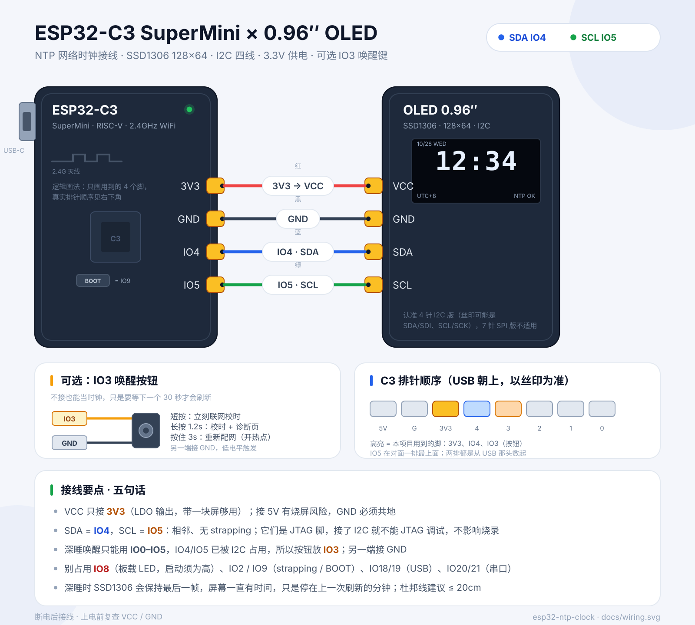
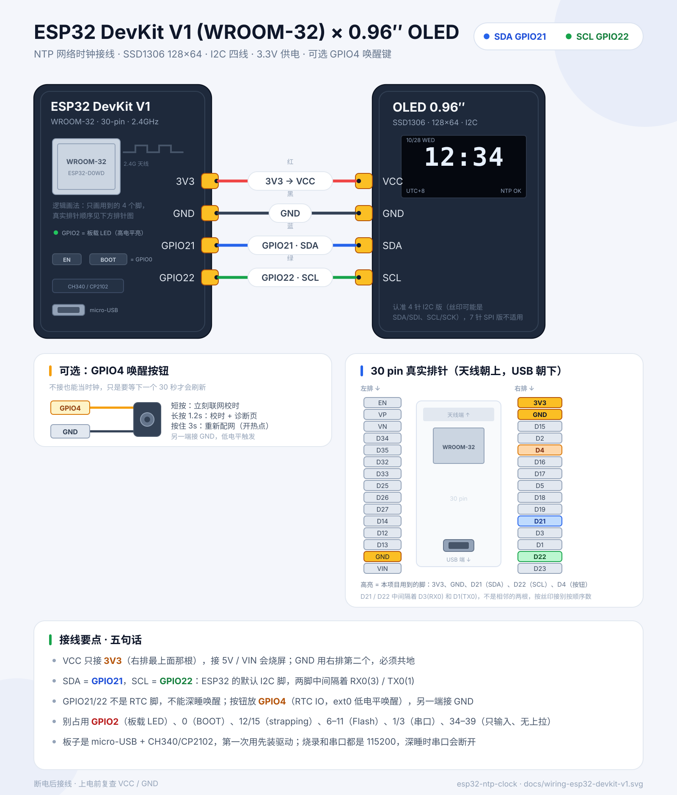
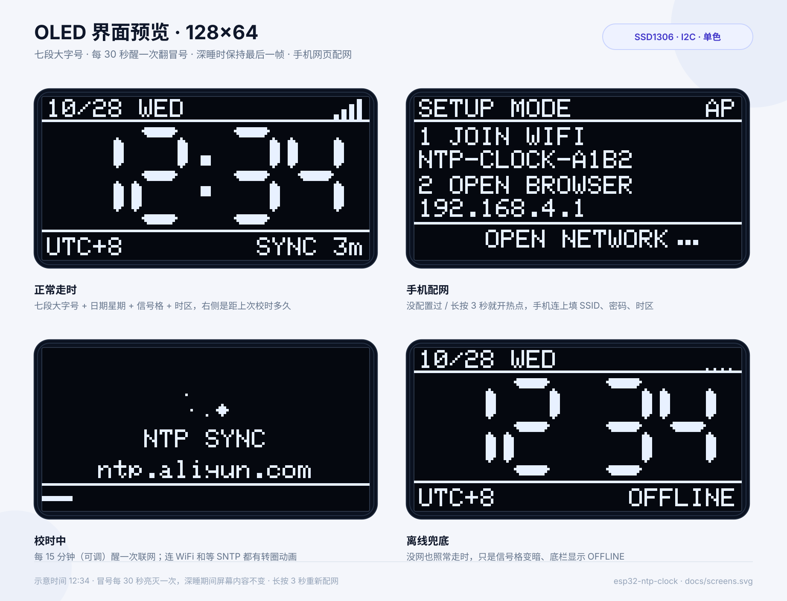

# ESP32 · OLED NTP 网络时钟（C3 SuperMini / DevKit V1 双板型）

一块 **ESP32** + 一块 **0.96″ SSD1306 OLED（128×64，I2C 四线）** 做的桌面网络时钟。开机连 WiFi、SNTP 校时，之后大部分时间在深睡，只在分钟边界醒来刷一帧；屏幕上的时间永远是对的（误差在秒级），因为它每 15 分钟就会自己再对一次表。

支持两种板子，接线和引脚不同，换板子就是换一个编译环境：

| | ESP32-C3 SuperMini | ESP32 DevKit V1（WROOM-32） |
| --- | --- | --- |
| PlatformIO 环境 | `esp32c3` | `esp32dev` |
| SDA | **IO4** | **GPIO21** |
| SCL | **IO5** | **GPIO22** |
| 按钮（可选） | IO3 | GPIO4 |
| 板载 LED | IO8（低电平亮） | GPIO2（高电平亮） |
| 深睡唤醒 | `gpio_wakeup`（GPIO0–5） | `ext0`（RTC GPIO） |
| USB | 原生 USB-C | micro-USB + CH340 / CP2102 |

第一次使用不用改代码：设备会开一个热点，手机连上填 WiFi 密码就行，配好的账号存在 NVS 里，掉电不丢。

## 接线图

**ESP32-C3 SuperMini**（SDA=IO4，SCL=IO5，按钮=IO3）



**ESP32 DevKit V1 / WROOM-32**（SDA=GPIO21，SCL=GPIO22，按钮=GPIO4）





## 功能

- **SNTP 校时**：默认阿里 / 腾讯 / pool 三个服务器，连上一个就够
- **两套板型**：ESP32-C3 SuperMini 和 ESP32 DevKit V1（WROOM-32），引脚、LED、深睡唤醒方式都自动适配
- **手机网页配网**：没配置过（或按住按钮 3 秒）就开热点 `NTP-CLOCK-XXXX`，手机连上填 SSID / 密码 / 时区，存进 NVS 掉电不丢，不用装 App、不用改代码
- **时区**：POSIX `TZ` 字符串，支持夏令时（中国用 `CST-8`，配网页里也能直接选）
- **七段大字号**：38px 的 `HH:MM`，顶栏日期 + 星期 + WiFi 信号格，底栏时区 + 校时状态
- **深睡 + 定时唤醒**：睡到下一个 30 秒边界，醒来只做「算时间 → 画一帧 → 继续睡」
- **自动校时**：每 15 分钟联网一次；失败 5 分钟后重试；完全没网时照常走时，底栏标 `OFFLINE`
- **漂移补偿**：用两次校时的实测误差算出内部 RC 计时的 ppm，睡前按比例缩放睡眠时长，分钟不会越走越偏
- **RTC 内存存时间**：深睡、按 RST、重新烧录都不丢时间基准；只有彻底断电才需要重新联网
- **可选唤醒按钮**：短按立刻校时，长按 1.2 秒看诊断页（IP / RSSI / 漂移 / 校时次数），按住 3 秒重新配网
- 自动探测 OLED 地址（`0x3C` / `0x3D`），串口打印每次唤醒和校时结果

## 硬件

| 元件 | 说明 |
| --- | --- |
| ESP32-C3 SuperMini | RISC-V，2.4GHz WiFi，板载 USB-C（原生 USB） |
| 或 ESP32 DevKit V1 | WROOM-32，双核 240MHz，30 pin，micro-USB + CH340 / CP2102 |
| OLED 0.96″ | SSD1306，128×64，**I2C 4 针版** |
| 杜邦线 | 4 根，建议 ≤ 20cm |
| 按钮（可选） | 6×6 轻触开关一个，另一端接 GND |
| 电阻（可选） | 10kΩ，按钮上拉到 3V3；不接一般也能用 |

> 7 针的 SPI 版 OLED 不适用；买的时候认准 4 针 I2C（GND / VCC / SCL / SDA）。
> 两种板子都只有 2.4GHz WiFi，5GHz 热点连不上。
> DevKit V1 有 30 pin 和 36 pin 两种版本，**30 pin 的排针顺序见接线图右下角**；36 pin 多的两脚在 USB 那头，不影响本项目用到的脚。

## 接线

### ESP32-C3 SuperMini

| OLED | ESP32-C3 | 线色 | 说明 |
| --- | --- | --- | --- |
| VCC | **3V3** | 红 | 一定接 3V3，不要接 5V |
| GND | **GND** | 黑 | 共地 |
| SDA | **IO4** | 蓝 | I2C 数据 |
| SCL | **IO5** | 绿 | I2C 时钟 |

### ESP32 DevKit V1（WROOM-32）

| OLED | DevKit V1 | 线色 | 说明 |
| --- | --- | --- | --- |
| VCC | **3V3** | 红 | 右排最上面那根；不要接 5V / VIN |
| GND | **GND** | 黑 | 右排第二根，共地 |
| SDA | **GPIO21** | 蓝 | ESP32 默认 SDA |
| SCL | **GPIO22** | 绿 | ESP32 默认 SCL |

> DevKit V1 上 GPIO21 和 GPIO22 **不是相邻的两根**，中间隔着 RX0(3) / TX0(1)，按丝印找，别按顺序数。

可选按钮：

| 板子 | 按钮一端 | 按钮另一端 | 说明 |
| --- | --- | --- | --- |
| ESP32-C3 | **IO3** | **GND** | GPIO 深睡唤醒（低电平） |
| DevKit V1 | **GPIO4** | **GND** | RTC IO，ext0 唤醒（低电平） |

注意事项：

- 以模块丝印为准找脚，不要数位置；丝印 `SDA` 也可能是 `SDI`，`SCL` 也可能是 `SCK`。
- I2C 地址一般是 `0x3C`，少数模块是 `0x3D`，固件会自动探测并打印到串口。
- C3 的 IO4 / IO5 同时是 JTAG 脚，用作 I2C 后不能再接 JTAG 调试，但不影响运行和烧录。
- C3 别占用 IO8（板载 LED）、IO2（strapping）、IO9（BOOT）、IO18/19（USB）、IO20/21（串口）。
- DevKit V1 别占用 GPIO2（板载 LED）、GPIO0（BOOT）、GPIO12 / GPIO15（strapping）、GPIO6–11（接 Flash）、GPIO1 / GPIO3（串口）、GPIO34–39（只输入，无内部上拉）。
- C3 深睡唤醒只能用 **IO0–IO5**，IO4/IO5 已经被 I2C 占了，所以按钮放 IO3。
- DevKit V1 只有 RTC GPIO 能唤醒（0 / 2 / 4 / 12–15 / 25–27 / 32–39），21/22 给了 I2C，所以按钮放 GPIO4；板载 BOOT 键（GPIO0）也能当唤醒键，但按住复位会进下载模式，不推荐。
- 按钮不接也能正常当时钟，只是不能「立刻校时」，要等下一个 30 秒醒来。

## 选板子 / 换板子

板型由 `platformio.ini` 的编译环境决定，引脚都在 `firmware/src/config.h` 开头的「板型」区：

```ini
[platformio]
default_envs = esp32c3      ; 不加 -e 时默认编译 C3

[env:esp32c3]               ; ESP32-C3 SuperMini
build_flags = -DBOARD_ESP32_C3 ...

[env:esp32dev]              ; ESP32 DevKit V1 (WROOM-32)
build_flags = -DBOARD_ESP32_DEVKIT_V1 ...
```

换板子只需要：

1. 按对应的接线图重新接线（SDA / SCL 换了脚）；
2. 编译烧录时带上环境名：`pio run -e esp32dev -t upload`；
3. 想改默认板子就改 `default_envs`。

两套引脚的差异已经封装在 `config.h` 里，`main.cpp` 不用改；按钮的唤醒方式也按板型自动切换（C3 用 `esp_deep_sleep_enable_gpio_wakeup()`，经典 ESP32 用 `esp_sleep_enable_ext0_wakeup()`）。

## 快速开始

需要 [PlatformIO](https://platformio.org/)（CLI 或 VSCode 插件都行）。

```bash
cd firmware

# ESP32-C3 SuperMini（默认环境）
pio run                                  # 编译
pio run -t upload                        # 烧录

# ESP32 DevKit V1 (WROOM-32)
pio run -e esp32dev
pio run -e esp32dev -t upload

pio device monitor                       # 串口 115200
```

第一次上电，屏幕会显示 `SETUP MODE`、热点名和 `192.168.4.1`。手机连上这个热点，浏览器打开 `192.168.4.1`，选 WiFi、填密码、选时区，保存后设备自动重启并校时（详见下面的「手机配网」）。

串口大概会看到（C3 的 `SDA=4 SCL=5`，DevKit V1 是 `SDA=21 SCL=22`）：

```text
[board] ESP32 DevKit V1 (WROOM-32 30-pin 2.4GHz)  SDA=21 SCL=22 BTN=4
[oled] 0x3C ok
[boot] #1 cause=0 time=no syncs=0 wifi=(none)
[setup] entering provisioning
[setup] AP NTP-CLOCK-A1B2  http://192.168.4.1
[setup] saved, restarting
[boot] #2 cause=0 time=no syncs=0 wifi=MyHome
[wifi] 192.168.1.42  -58 dBm  1832ms
[sleep] 21.40s -> 12:34:30 (ppm +0)
```

之后的每次唤醒只有一行，方便确认它还活着：

```text
[boot] #97 cause=4 time=yes syncs=12 wifi=MyHome
[sleep] 29.40s -> 13:07:00 (ppm +1830)
```

`cause=4` 是定时唤醒，`cause=0` 是上电 / 复位，按钮唤醒在 C3 上是 `cause=7`（GPIO），在 DevKit V1 上是 `cause=2`（ext0）。

> 也可以不用配网页：把 `src/secrets.h.example` 复制成 `src/secrets.h`，填好 `WIFI_SSID` / `WIFI_PASSWORD` 编译进固件当默认值。NVS 里配过的账号优先于它。

VSCode 里也可以直接打开 `firmware/`，在底部状态栏切换环境后点 **Upload** 和 **Monitor**。

### 烧录失败怎么办

1. 换一根**能传数据**的 USB 线（很多线只能充电）。C3 用 USB-C，DevKit V1 用 micro-USB。
2. 按住板载 **BOOT** 不放，点一下 **EN / RST**，松开 BOOT，再执行 `pio run -t upload`（DevKit V1 记得带 `-e esp32dev`）。
3. 还不行就把 `platformio.ini` 里的 `upload_speed` 降到 `115200`。
4. DevKit V1 的串口走 CH340 / CP2102：设备管理器里看不到 `COMx` 就先装对应驱动，别用只有充电功能的线。

## 手机配网（第一次使用 / 换 WiFi）

设备没配过网，或者你按住按钮 3 秒（C3 是 IO3，DevKit V1 是 GPIO4），它就会进入配网模式：

1. 屏幕显示 `SETUP MODE`、热点名 `NTP-CLOCK-XXXX` 和 `192.168.4.1`。
2. 手机打开 WiFi 列表，连上 `NTP-CLOCK-XXXX`（开放热点，不需要密码；提示「无法上网」时选保持连接）。
3. 一般会自动弹出配网页；没弹就用浏览器打开 **http://192.168.4.1**。
4. 选 2.4GHz WiFi（隐藏网络用「手动输入 SSID」），填密码，选时区，点「保存并重启」。
5. 设备重启、联网校时，几秒内屏幕出时间。

几点说明：

- 只支持 **2.4GHz**，5GHz 热点搜不到也连不上。
- 密码留空 = 沿用上一次保存的密码；换到新路由器时记得重填。
- 配网页只开 10 分钟，没人操作就自动关闭，设备睡 5 分钟后再开一次；想立刻再开就按住按钮 3 秒。
- 配置存在 NVS（namespace `clock`），掉电、重新烧录固件都不会丢。要彻底清空用 `pio run -t erase`。
- 连续 3 次校时失败、而且完全没有时间基准时，也会自动回到配网模式（比如换了路由器）。
- 配网页里选的时区会覆盖 `config.h` 的默认值，屏幕底栏标签也跟着变。

配网时的屏幕：

```text
┌────────────────────────────────┐
│ SETUP MODE                  AP │
├────────────────────────────────┤
│ 1 JOIN WIFI                    │
│ NTP-CLOCK-A1B2                 │
│ 2 OPEN BROWSER                 │
│ 192.168.4.1                    │
├────────────────────────────────┤
│         OPEN NETWORK...        │
└────────────────────────────────┘
```

## 时区怎么改

最方便的是在配网页面里直接选，存进 NVS 后优先于下面的默认值。想改编译进固件的默认值，就改 `firmware/src/config.h` 里的两行：

```c
#define TZ_STRING  "CST-8"    // POSIX TZ
#define TZ_LABEL   "UTC+8"    // 屏幕底栏显示的短标签
```

**注意 POSIX 的符号是反的**：UTC+8 要写成 `CST-8`，写成 `CST+8` 会差 16 小时。

| 地区 | TZ_STRING | TZ_LABEL |
| --- | --- | --- |
| 中国 | `CST-8` | `UTC+8` |
| 香港 / 台北 | `HKT-8` | `UTC+8` |
| 日本 | `JST-9` | `UTC+9` |
| 韩国 | `KST-9` | `UTC+9` |
| 美东（含夏令时） | `EST5EDT,M3.2.0,M11.1.0` | `ET` |
| 美西（含夏令时） | `PST8PDT,M3.2.0,M11.1.0` | `PT` |
| 英国（含夏令时） | `GMT0BST,M3.5.0/1,M10.5.0` | `UK` |
| 欧洲中部（含夏令时） | `CET-1CEST,M3.5.0,M10.5.0/3` | `CET` |

带夏令时的写法里，`M3.2.0` 表示「3 月第 2 个周日」，`/1` 是切换时刻（当地 1 点）。不确定就先用不带 DST 的固定偏移。

## 深睡眠是怎么工作的

这是整个项目最关键的部分，搞明白了改代码就很容易。

1. **醒来**：定时器唤醒后，时间不是从系统时钟读的（深睡后系统时间会归零），而是从 RTC 内存里拿「计划唤醒时刻」，所以每次醒来都对得齐整分。
2. **画一帧**：把 `HH:MM`、日期、星期、信号格、时区、校时状态画进 SSD1306 的显存，推一次 I2C，约 25ms。
3. **算下一次**：目标时刻是下一个 30 秒边界（`(now / 30s + 1) * 30s`），把睡眠时长交给 `esp_sleep_enable_timer_wakeup()`。
4. **睡前补偿**：内部 RC 计时和真实秒长有偏差（实测常见 ±0.1%–2%）。每次成功校时时，用「真实流逝时间 ÷ 内部计时走过的微秒」算出 ppm，睡前把时长按 `1 + ppm/1e6` 缩放，越睡越准。
5. **校时**：到了 `SYNC_INTERVAL_MIN`（默认 15 分钟）就顺手连 WiFi 校一次时；失败则 5 分钟后重试，不影响走时。
6. **OLED 不关**：SSD1306 有自己的显存，MCU 睡死以后屏幕继续显示最后一帧。所以 30 秒醒一次是为了让冒号闪、分钟准点翻，而不是为了点亮屏幕。

按钮唤醒（C3 的 IO3 / DevKit V1 的 GPIO4）有个小坑：深睡期间拿不到真实睡了多久，所以固件先用「睡前时刻」兜底，并立刻联网校时把时间拉回来。这也是为什么短按一定会联网。

### 功耗（估算，不是实测）

| 状态 | 电流 | 占比 |
| --- | --- | --- |
| MCU 深睡（C3） | ~5 µA | 可忽略 |
| MCU 深睡（DevKit V1） | ~1–10 mA | 板载 LDO + USB 芯片在耗电 |
| OLED 常亮显示 | 10–20 mA | **绝对大头** |
| 每 30 秒刷一帧（25ms） | 平均 ~0.1 mA | 很小 |
| 每 15 分钟连 WiFi 校时（2–4s） | 平均 ~0.2 mA | 很小 |

所以整机平均大概 **12–20 mA**（DevKit V1 再高一截），1000mAh 的电池也就 2–3 天 —— 瓶颈是 OLED 本身，不是 ESP32。想更省电：

- 用 USB 供电，别折腾电池（最省心）。
- 电池供电优先用 C3 SuperMini：它没有 USB 转串口芯片，深睡电流比 DevKit V1 低一个数量级。
- 把 `CLOCK_BLINK_COLON` 设为 `0`，每分钟才醒一次。
- 把 `SYNC_INTERVAL_MIN` 调大（比如 60），联网次数更少。
- 真要电池跑几个月，得换 e-paper 或者「按一下才亮屏」的方案。

## 操作

| 操作 | 效果 |
| --- | --- |
| 自动（每 30 秒） | 醒来刷新冒号 / 分钟 |
| 自动（每 15 分钟） | 联网 SNTP 校时 |
| 短按按钮 | 立刻校时并刷新 |
| 长按按钮 1.2 秒 | 校时后显示诊断页 8 秒（IP / RSSI / 漂移 / 校时次数） |
| 按住按钮 3 秒 | 开热点重新配网，保存后自动重启 |
| 断电再上电 | 自动连上次配好的 WiFi 校时，不用重新配网 |

## 界面说明

```text
┌────────────────────────────────┐
│ 10/28 WED              ▂▄▆█    │  日期 星期 / WiFi 信号格
├────────────────────────────────┤
│  ██  ██   ██  ██               │
│   █   █    █   █               │  七段数字 38px，冒号每 30s 闪
│  ██  ██   ██  ██               │
├────────────────────────────────┤
│ UTC+8                SYNC 3m   │  时区 / 距上次成功校时
└────────────────────────────────┘
```

- 底栏右侧：`NTP OK`（刚校过）、`SYNC 12m`（12 分钟前）、`OFFLINE`（超过 100 分钟没校上）、`NO NTP`（从没成功过）。
- 信号格暗掉 = 最近 30 分钟内没成功联网，不代表 WiFi 现在一定断（深睡时 WiFi 是关的）。
- 12 小时制（`CLOCK_12H 1`）时，底栏左边显示 `AM` / `PM`，小时不补前导零。

## 目录结构

```text
esp32-ntp-clock/
├── firmware/
│   ├── platformio.ini
│   └── src/
│       ├── config.h          # 引脚、时区、校时周期、深睡策略
│       ├── secrets.h.example # 可选：编译进固件的默认 WiFi
│       ├── provision.h/.cpp  # 手机配网：AP 热点 + 网页表单 + NVS 存储
│       ├── ui.h / ui.cpp     # OLED：七段数字、顶栏底栏、等待页、配网页
│       └── main.cpp          # 联网、SNTP、RTC 状态、深睡与漂移补偿
├── docs/
│   ├── wiring.svg                    # 接线图 · ESP32-C3 SuperMini
│   ├── wiring-esp32-devkit-v1.svg    # 接线图 · ESP32 DevKit V1 (WROOM-32)
│   └── screens.svg                   # 界面预览（用真实字库 + 同样的几何渲染）
├── tools/
│   └── render_preview.py     # 重新生成 docs/screens.svg
└── README.md
```

## 可调参数

都在 `firmware/src/config.h`：

| 宏 | C3 默认 | DevKit V1 默认 | 作用 |
| --- | --- | --- | --- |
| `BOARD_ESP32_C3` / `BOARD_ESP32_DEVKIT_V1` | 定义 | 定义 | 板型开关，由 `platformio.ini` 的 `build_flags` 传进来 |
| `I2C_SDA_PIN` | 4 | 21 | OLED SDA |
| `I2C_SCL_PIN` | 5 | 22 | OLED SCL |
| `BTN_PIN` | 3 | 4 | 唤醒按钮（低电平触发） |
| `LED_PIN` | 8 | 2 | 板载 LED |
| `LED_ACTIVE_LOW` | 1 | 0 | 板载 LED 极性 |
| `OLED_I2C_ADDR` | 0x3C | 0x3C | 首选地址，失败自动试 0x3D |
| `TZ_STRING` | `CST-8` | `CST-8` | POSIX 时区，支持夏令时 |
| `TZ_LABEL` | `UTC+8` | `UTC+8` | 底栏短标签 |
| `CLOCK_12H` | 0 | 0 | 1 = 12 小时制 |
| `CLOCK_BLINK_COLON` | 1 | 1 | 1 = 每 30 秒醒一次闪冒号 |
| `CLOCK_GHOST_SEGMENTS` | 0 | 0 | 1 = 用细线勾出未点亮的笔画 |
| `SYNC_INTERVAL_MIN` | 15 | 15 | 多久联网校一次时 |
| `SYNC_RETRY_MIN` | 5 | 5 | 失败后多久重试 |
| `WIFI_CONNECT_TIMEOUT_MS` | 12000 | 12000 | 连 WiFi 超时 |
| `NTP_TIMEOUT_MS` | 8000 | 8000 | 等 SNTP 超时 |
| `BTN_LONG_MS` | 1200 | 1200 | 长按判定（诊断页） |
| `BTN_PROVISION_MS` | 3000 | 3000 | 按住多久进入配网 |
| `DIAG_HOLD_SEC` | 8 | 8 | 诊断页停留秒数 |
| `PROVISION_TIMEOUT_MS` | 10 分钟 | 10 分钟 | 配网热点最长开启时间 |
| `PROVISION_RETRY_SEC` | 300 | 300 | 配网超时后隔多久再开 |

## 实现要点

- **时间基准存在 RTC 内存**：`RTC_DATA_ATTR` 的 `Persist` 结构里放「当前时刻 / 计划唤醒时刻 / 上次校时 / 累计内部计时 / 漂移 ppm」。深睡和复位都不清，只有断电才清。
- **分钟对齐**：醒来直接把时间设成「计划唤醒时刻」，而不是累加睡眠时长，避免每次醒来都攒一点误差。
- **漂移补偿**：`scalePpm = (内部走过的微秒 / 真实流逝微秒 - 1) × 1e6`，睡前 `sleep = 目标时长 × (1 + scalePpm/1e6)`。实测偏差做 4 次滑动平均，限制在 ±5% 以内，防止一次异常校时把系数带飞。
- **只画一帧**：没有 `loop()` 里的动画，所有内容一次画完再睡，I2C 只推一帧（1KB / 400kHz ≈ 25ms）。
- **按钮**：C3 用 `esp_deep_sleep_enable_gpio_wakeup()`（GPIO0–5，低电平）；经典 ESP32 没有这个 API，用 `esp_sleep_enable_ext0_wakeup()`（RTC GPIO，低电平）。长按判断放在醒来之后做，因为深睡里没法计时。
- **配网**：`WiFi.softAP()` 开一个开放热点，`DNSServer` 把所有域名都指到 `192.168.4.1`（手机的联网检测请求会落到配网页，所以大概率自动弹窗），`WebServer` 出一个表单；账号密码 / 时区存 `Preferences`（NVS，namespace `clock`）。保存后 `ESP.restart()` 走正常启动流程。
- **何时进配网**：按住按钮 3 秒 / NVS 里没有 SSID / 连续 3 次校时失败且完全没有时间基准。配网超时不会卡死，睡 5 分钟后自动再开一次热点。
- **校时精度**：SNTP 一次往返，误差在 10ms 量级；屏幕只显示到分钟，所以够用。真正影响观感的是深睡计时的漂移，靠上面的补偿压到秒级。
- **12 小时制 / 时区**：`setenv("TZ", ...)` + `tzset()` + `localtime_r()`，没有自己写时区表，所以 DST 规则交给 newlib 处理。

## 常见问题

**屏幕全黑，串口也没有 `[oled] found`**

先看串口第一行 `[board]`，确认烧录的板型和接线对得上：

- C3：SDA 接 **IO4**、SCL 接 **IO5**；
- DevKit V1：SDA 接 **GPIO21**、SCL 接 **GPIO22**。

再确认 VCC 是 3V3、GND 共地；有些模块丝印顺序是 `GND VCC SCL SDA`，别按位置插。地址不对时固件会自动试 `0x3D`。

**串口监视器没有输出**

C3：确认用的是板子上的 USB-C 口、线能传数据；`platformio.ini` 已经打开 `ARDUINO_USB_MODE=1` 和 `ARDUINO_USB_CDC_ON_BOOT=1`，监视器波特率 115200。深睡后 USB 会断开，这是正常的，醒来那一瞬间才会重新出现。

DevKit V1：串口走 CH340 / CP2102，不是原生 USB。先在设备管理器里确认有 `COMx` 并且驱动装好了，再 `pio device monitor -e esp32dev`；烧录时记得也带 `-e esp32dev`。

**时间差了整整 8 小时 / 16 小时**

时区字符串写错了。POSIX 的符号是反的：UTC+8 写 `CST-8`。差 16 小时通常是写成了 `CST+8`。

**时间越走越偏，几分钟就差一截**

说明一直没校上时（底栏显示 `OFFLINE`）。先看串口有没有 `[wifi] timeout` / `[sleep]` 行，再查路由器是否封了 UDP 123；也可以把 `SYNC_INTERVAL_MIN` 调小到 5 分钟观察。漂移补偿需要至少两次成功校时才会生效。

**WiFi 连不上**

两种板子都只支持 2.4GHz；按住按钮 3 秒重新配网，确认选的是 2.4G 那个、密码没有多余空格。企业认证（WPA2-Enterprise）和需要网页登录的酒店 / 校园网不支持。

**手机连上了 `NTP-CLOCK-XXXX`，但配网页打不开**

先手动打开浏览器访问 `http://192.168.4.1`（有些系统不会自动弹窗）。如果提示「此 WLAN 无法上网」，选「保持连接 / 继续使用」；把移动数据和 VPN 关掉再试。还不行就换一台手机，或者按住按钮 3 秒重新开热点。

**NTP 一直失败**

有些路由器 / 公司网会封 UDP 123。换一个服务器（比如 `time.cloudflare.com`），或者用手机热点试一下。

**按按钮没反应**

确认一端接的是 **C3 的 IO3 / DevKit V1 的 GPIO4**，另一端接 GND（不是 3V3）。深睡时内部上拉由 IDF 打开，一般够用；如果按钮线比较长，加一个 10kΩ 上拉到 3V3 更稳。另外按一下要持续几十毫秒，太快的轻点可能来不及触发唤醒。DevKit V1 如果改用了 GPIO34–39，这些脚没有内部上拉，必须外接电阻。

**屏幕上有残影 / 担心烧屏**

OLED 长时间显示同一画面会留残影。本项目每分钟都会重画，问题不大，但别把亮度开到最高、别让同一画面挂几个月。不用的时候直接断电。

**深睡以后屏幕还亮着，是不是没睡？**

是正常的：SSD1306 有自己的显存，MCU 睡了它也会继续显示最后一帧。判断有没有睡，看串口有没有 `[sleep]` 行，或者量一下电流（C3 深睡时只有几微安，DevKit V1 因为板载 USB 芯片会高一些）。

## 重新生成界面预览

`screens.svg` 是用**真实的 Adafruit 5×7 字库**、加上和 `ui.cpp` 完全相同的七段几何逐像素渲染的，不是手画的：

```bash
# 先编译一次，让 PlatformIO 下载 Adafruit GFX
cd firmware && pio run
cd ..
python3 tools/render_preview.py
```

改了 `ui.cpp` 里的坐标，记得同步 `tools/render_preview.py`，否则预览和真机就对不上了。
