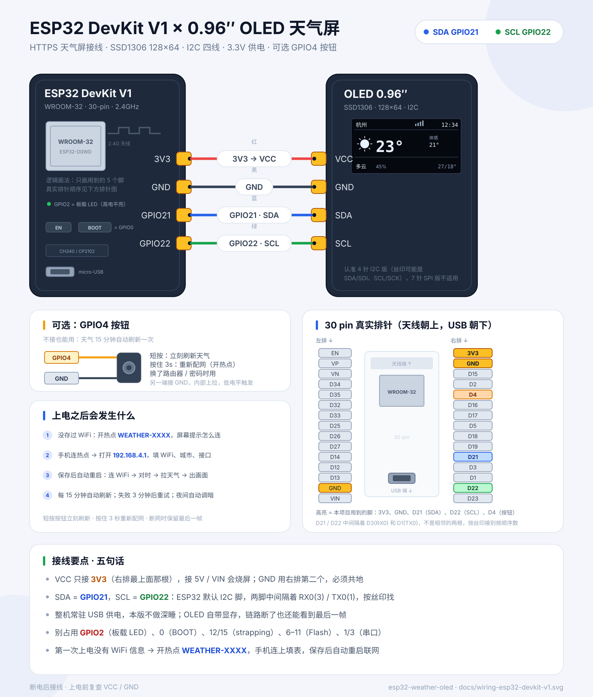

# ESP32 · OLED 天气屏（DevKit V1 + 0.96″ SSD1306）

一块 **ESP32 DevKit V1** + 一块 **0.96″ OLED（128×64，I2C 四线）** 做的桌面天气屏：

- 手机网页配网：不用改代码、不用装 App，WiFi / 城市 / 时区 / 数据源都存 NVS
- HTTPS 拉天气 + ArduinoJson 解析
- 图标不是贴图，是 32×32 的几何图形现场画的（太阳、月亮、云、雨、雪、雷、雾）
- 默认走 **Open-Meteo**（免 API Key）；也能切到 **OpenWeather**（填自己的 Key）
- 中文界面（U8g2 的 WQY 12px GB2312 字库）
- 15 分钟刷新一次天气，失败 3 分钟重试；时间每分钟走一格；22:00–07:00 自动调暗



## 先说结论：新建项目，但配网不要重写

这个仓库里已经有一个 `esp32-ntp-clock`，它的 **AP 热点 + 网页表单 + NVS 存储** 已经跑通过，正好是天气屏需要的「配网」能力。

所以做法是：

1. **新建一个项目** `esp32-weather-oled`，不要把天气逻辑塞进时钟项目；
2. 把时钟项目的 `provision.cpp` / `provision.h` 复制过来，字段从「时区」扩展成「城市 / 经纬度 / 数据源 / API Key」；
3. 配网 UI 换几行字，逻辑不动。

不需要做 WiFi「授权」（WPA2-Enterprise、OAuth、Captive Portal 登录那一套）。桌面玩具只要 **配网 provisioning**：设备开热点 → 手机填表 → 存 NVS → 重启连家里 WiFi。企业 / 校园网那种要网页登录的 WiFi，ESP32 本来也不好搞，直接放弃。

> 为什么不把配网抽成公共库？两个项目依赖不同（时钟用 Adafruit GFX，天气屏用 U8g2），配网模块只有 300 行，复制一份再改字段，比维护一个带条件编译的公共库省事。等第三个项目也要用，再抽。

## 数据源怎么选

| | Open-Meteo（默认） | OpenWeather | 和风天气 QWeather |
| --- | --- | --- | --- |
| API Key | **不需要** | 需要（注册后 Key 可能要等十几分钟生效） | 需要 |
| 免费额度 | 非商业 10k 次/天 | 2.5 接口 60 次/分 | 按量计费 + 免费额度（会变） |
| HTTPS + JSON | ✅ | ✅ | ✅ |
| 中文描述 | 自己按 WMO 代码映射 | `lang=zh_cn` 直接返回 | ✅ |
| 2026 现状 | 稳定 | 2.5 接口仍可用；One Call 3.0 要绑卡 | **新控制台改成独立 API Host + gzip + JWT**，老 `devapi.qweather.com` 在逐步退出，ESP32 上成本明显更高 |
| 本项目支持 | ✅ | ✅ | ❌（留了 Provider 接口，见文末） |

**推荐先用 Open-Meteo**：不注册、不绑卡、没有 Key 泄露问题，城市名还能用它的 Geocoding 自动转经纬度。等你想用 OpenWeather 的中文描述或图标代码，再在配网页里切过去。

> 和风不是不能用，是 2026 年的接入方式对单片机不友好：要自己的 API Host、响应默认 gzip（Arduino `HTTPClient` 不会自动解压）、新账号推荐 JWT（Ed25519 签名）。为了一个天气屏引入这些不划算，所以这版先不做。

## 硬件

| 元件 | 说明 |
| --- | --- |
| ESP32 DevKit V1 | WROOM-32，30 pin，micro-USB + CH340 / CP2102 |
| OLED 0.96″ | SSD1306，128×64，**I2C 4 针**（GND / VCC / SCL / SDA） |
| 杜邦线 | 4 根，建议 ≤ 20cm |
| 按钮（可选） | 6×6 轻触开关，一端 GPIO4，一端 GND |

> 7 针 SPI 版 OLED 不适用，买的时候认准 4 针 I2C。
> ESP32 只支持 2.4GHz WiFi，5GHz 热点连不上。

## 接线

| OLED | DevKit V1 | 线色 | 说明 |
| --- | --- | --- | --- |
| VCC | **3V3** | 红 | 右排最上面那根；不要接 5V / VIN |
| GND | **GND** | 黑 | 右排第二根，共地 |
| SDA | **GPIO21** | 蓝 | ESP32 默认 SDA |
| SCL | **GPIO22** | 绿 | ESP32 默认 SCL |

可选按钮：

| 按钮一端 | 按钮另一端 | 作用 |
| --- | --- | --- |
| **GPIO4** | **GND** | 短按立刻刷新；按住 3 秒重新配网 |

注意：

- GPIO21 / GPIO22 **不是相邻的两根**，中间隔着 RX0(3) / TX0(1)，按丝印找。
- I2C 地址一般是 `0x3C`，少数模块是 `0x3D`，固件会自动探测。
- 别占用 GPIO2（板载 LED）、GPIO0（BOOT）、GPIO12 / GPIO15（strapping）、GPIO6–11（Flash）、GPIO1 / GPIO3（串口）。

## 快速开始

需要 [PlatformIO](https://platformio.org/)（CLI 或 VSCode 插件都行）。

```bash
cd firmware

pio run                 # 编译
pio run -t upload       # 烧录（DevKit V1 走 CH340/CP2102，先装驱动）
pio device monitor      # 串口 115200
```

第一次编译会下载 U8g2 和 ArduinoJson。因为中文字库比较大，`platformio.ini` 里用了 `huge_app.csv` 分区（3MB app），4MB Flash 的板子直接能烧。当前固件约占 1.2MB Flash / 50KB RAM。

### Windows 编译报错：`CreateProcess: No such file or directory`

```
xtensa-esp32-elf-g++: error: CreateProcess: No such file or directory
```

这**不是**代码问题，也不是工具链没装好。ESP32 Arduino 框架会给每个 `.cpp` 加上两三百条 `-I`，而这些路径里带着 `C:\Users\<用户名>\.platformio\packages\framework-arduinoespressif32@<版本>`，用户名一长，g++ 的命令行就超过 Windows `CreateProcess` 的 **32767 字符**上限（实测这台机器是 32652）。工具链自身没问题，单独编个小文件是能过的。

解法是让 PlatformIO 从一个短路径读 `packages`：

```bat
:: 建一个目录 junction（普通用户权限即可）
cmd /c mklink /J C:\pio C:\Users\%USERNAME%\.platformio
```

```bash
cd firmware
copy platformio.local.ini.example platformio.local.ini
```

`platformio.ini` 里已经写了 `extra_configs = platformio.local.ini`，这个文件里只有一行 `core_dir = C:/pio`，命令行立刻短几千字符。这个文件在 `.gitignore` 里，不会提交；换台路径正常的机器不建它也能编译。

### 第一次上电

1. 屏幕显示 `配网模式`，热点名 `WEATHER-XXXX`（XXXX 是 MAC 后两位）。
2. 手机连上这个**开放热点**（提示「无法上网」时选保持连接）。
3. 浏览器一般会自动弹出配网页；没弹就手动打开 **http://192.168.4.1**。
4. 选 2.4GHz WiFi、填密码、填城市（例如 `杭州`）、选时区、选数据源。
5. 点「保存并重启」。设备连 WiFi → SNTP 校时 → 城市转经纬度 → 拉天气 → 出画面。

配网页只开 10 分钟。超时后设备会继续重试联网，5 分钟后再开一次热点；也可以随时按住 GPIO4 按钮 3 秒重新进配网。

如果 WiFi 密码填错、或者路由器换了名字，设备开机 10 分钟后会**自动再开一次热点**（每个开机周期只自动一次），所以就算没接按钮也不至于变砖。

## 界面

```text
┌────────────────────────────────┐
│ 杭州              12:34  ▂▄▆   │  城市 / 时间 / WiFi 信号
├────────────────────────────────┤
│   ☀       23°      体感         │  32×32 图标 / 大温度 / 体感
│                    21°          │
├────────────────────────────────┤
│ 多云  💧45%            27/18°   │  天气 / 湿度 / 今日最高最低
└────────────────────────────────┘
```

- 温度用 `logisoso30`；三位数或负温度会自动换成 24px，避免和右边的体感挤在一起。
- 底栏最多显示 4 个汉字；如果最高/最低温度带负号，湿度会自动让位，不叠字。
- 数据超过 30 分钟没更新，右上角出 `!`，底栏湿度变成 `离线`。
- 屏幕上的时间每分钟刷新；天气数据 15 分钟拉一次，失败 3 分钟后重试。

## HTTPS / TLS 说明

默认 `TLS_VERIFY = 0`：

```cpp
WiFiClientSecure client;
client.setInsecure();   // 流量仍然加密，但不验证服务器身份
```

这样第一次就能跑通，不会因为根证书轮换 / 系统时间没对上而卡死。天气数据本身不敏感；但 **OpenWeather 的 Key 在 URL 里**，如果你介意中间人攻击，建议打开校验：

```cpp
// config.h
#define TLS_VERIFY 1
```

然后把 `src/certs.h.example` 复制成 `src/certs.h`：

- Open-Meteo / Geocoding：内置 ISRG Root X1（Let's Encrypt，2026 年的中间证书 YR1 / YR2 → Root YR 都挂在它下面）
- OpenWeather：内置 **Sectigo Public Server Authentication Root R46**（2026 年实测的根）+ 旧的 USERTrust RSA 备用

设备会先 SNTP 校时，再发 HTTPS 请求（证书校验需要正确时间）。证书轮换后如果报 TLS 错误，用 `openssl s_client -showcerts` 重新取根证书，或者把 `TLS_VERIFY` 改回 0。

## JSON 解析

两个数据源都解析成同一个 `Weather` 结构：

```cpp
enum class Sky { Clear, Partly, Cloudy, Overcast, Fog,
                 Drizzle, Rain, HeavyRain, Snow, Thunder, Unknown };

struct Weather {
  bool valid;
  Sky sky;
  bool isDay;
  float temp, feels, tmax, tmin;
  int humidity;
  float windKph;
  int windDeg;
  char text[20];      // 中文短描述，最多 4 个汉字
  uint32_t fetchedAt;
};
```

- **Open-Meteo**：`current.temperature_2m`、`relative_humidity_2m`、`apparent_temperature`、`is_day`、`weather_code`、`wind_speed_10m`；`daily.temperature_2m_max[0]` / `min[0]`。WMO 代码自己映射成中文和 `Sky`。
- **OpenWeather**：`main.temp` / `feels_like` / `temp_max` / `temp_min` / `humidity`、`weather[0].id` / `description` / `icon`、`wind.speed` / `deg`。`icon` 末尾 `d` / `n` 判断白天黑夜。
- 解析用 **ArduinoJson 7**，整个响应一次读进 `JsonDocument`，几百字节到 1KB，ESP32 内存无压力。

城市名 → 经纬度走 Open-Meteo Geocoding（免 Key），解析成功后把 `lat` / `lon` 存进 NVS，之后不再查。也可以在配网页的「纬度 / 经度」里手动填，完全跳过 Geocoding。

## 图标怎么画

没有用图片数组，全部是 `U8g2` 的 `drawDisc` / `drawCircle` / `drawLine` / `drawBox` 拼的 32×32 矢量图标：

- 太阳：实心圆 + 8 条射线（射线画两遍加粗）
- 月亮：实心圆，再用黑色圆偏移擦出月牙，加两颗小星星
- 云：三个圆 + 一条底边；「多云」用小一号的云
- 雨：云 + 斜线；暴雨 4 条长线
- 雪：云 + 三个六角雪花（横竖 + 两条斜线）
- 雷：云 + 折线闪电
- 雾：云 + 三条横线
- 阴：实心云 + 两道黑色缝隙，做出「两层云」的感觉

好处是换分辨率、换主题都不用重新做图；坏处是图标偏「线条画」，不是拟物风。想换成 BMP / XBM 位图，只要改 `icons.cpp` 里的 `iconDraw()`，`ui.cpp` 不用动。

## 刷新策略 / 功耗

这版是 **常驻供电** 的方案（USB 插着），没有做深睡：

- 天气：15 分钟一次；失败 3 分钟重试
- 时间：每分钟重画一次（只走 I2C，1KB 显存约 25ms）
- WiFi：连着，开 modem sleep；掉线后下次刷新时重连
- 夜间：22:00–07:00 对比度降到 30（`NIGHT_CONTRAST`）

桌面 USB 供电完全够。想上电池，可以把 `main.cpp` 改成和 `esp32-ntp-clock` 一样的深睡结构：醒来 → 连 WiFi → 拉一次 → 画一帧 → `esp_sleep_enable_timer_wakeup()`。OLED 有自己的显存，睡了你也能继续看到最后一帧；但 DevKit V1 板载 USB 芯片本身耗电，真要用电池建议换 C3 SuperMini。

## 目录结构

```text
esp32-weather-oled/
├── firmware/
│   ├── platformio.ini
│   ├── platformio.local.ini.example  # 可选：本机短路径（Windows 命令行超长时）
│   └── src/
│       ├── config.h          # 引脚、刷新周期、夜间调光、TLS 开关
│       ├── certs.h.example   # 可选：HTTPS 根证书
│       ├── secrets.h.example # 可选：把 WiFi 编译进固件
│       ├── provision.h/.cpp  # AP 热点 + 网页表单 + NVS（从时钟项目复用）
│       ├── net.h/.cpp        # WiFi / SNTP / HTTPS GET
│       ├── weather.h/.cpp    # Open-Meteo / OpenWeather + JSON 解析
│       ├── icons.h/.cpp      # 32×32 矢量天气图标
│       ├── ui.h/.cpp         # OLED 布局（中文 + 大温度）
│       └── main.cpp          # 启动流程、刷新调度、按钮
├── docs/
│   └── wiring-esp32-devkit-v1.svg
├── tools/
│   └── check_font_glyphs.py  # 解析 U8g2 字库，检查界面上的字有没有缺字
└── README.md
```

## 可调参数

都在 `firmware/src/config.h`：

| 宏 | 默认 | 作用 |
| --- | --- | --- |
| `I2C_SDA_PIN` / `I2C_SCL_PIN` | 21 / 22 | OLED 引脚 |
| `BTN_PIN` | 4 | 按钮（低电平触发） |
| `BTN_PROVISION_MS` | 3000 | 按住多久进配网 |
| `REFRESH_MIN` | 15 | 天气刷新间隔（分钟） |
| `RETRY_MIN` | 3 | 失败重试间隔（分钟） |
| `WIFI_RETRY_SEC` | 30 | 掉线后多久重连 |
| `WIFI_LOST_PROVISION_MIN` | 10 | 有配置但连不上，多久后自动开一次热点 |
| `NTP_RESYNC_HOURS` | 6 | 多久重新校时 |
| `NIGHT_DIM` | 1 | 夜间调光开关 |
| `NIGHT_START_HOUR` / `NIGHT_END_HOUR` | 22 / 7 | 夜间时段 |
| `NIGHT_CONTRAST` / `DAY_CONTRAST` | 30 / 255 | OLED 对比度 |
| `TLS_VERIFY` | 0 | 1 = 校验证书（需要 `certs.h`） |
| `DEFAULT_PROVIDER` | 0 | 0 = Open-Meteo，1 = OpenWeather |
| `PROVISION_TIMEOUT_MS` | 10 分钟 | 配网热点最长开启时间 |

## 常见问题

**屏幕全黑，串口也没有 `[oled] ok`**

先看串口 `[oled] not found`。确认 VCC 接 3V3、GND 共地、SDA=GPIO21、SCL=GPIO22，别按排针顺序数。地址 `0x3C` / `0x3D` 固件都会试。

**中文变成方块 / 乱码**

源码必须是 UTF-8（`platformio.ini` 已经加了 `-finput-charset=UTF-8 -fexec-charset=UTF-8`）。如果自己加了字库外的生僻字，U8g2 的 GB2312 字库里没有，换字或换字库。改完界面文字可以跑一下检查：

```bash
python tools/check_font_glyphs.py    # 需要先 pio run 过一次（U8g2 已下载）
```

**城市定位失败**

城市名写得太偏（例如小区名）会查不到。换成「杭州」「北京」「Shenzhen」这种城市级名称，或者在配网页手动填经纬度（纬度 -90~90，经度 -180~180）。

**OpenWeather 返回 401 / API Key 无效**

新注册的 Key 有时要等 10–20 分钟才生效；确认没有多余空格；确认用的是 2.5 的 Current Weather 接口（本项目用的就是它），不是 One Call 3.0。

**HTTPS 一直失败 / TLS 报错**

先把 `TLS_VERIFY` 改回 0 排除证书问题；如果 0 也失败，看串口里的 `[http]` 行，常见原因是 WiFi 没连上、路由器拦了 443、或者设备时间不对（只影响校验模式）。

**手机连上 `WEATHER-XXXX` 但配网页打不开**

手动访问 `http://192.168.4.1`；提示「此 WLAN 无法上网」时选保持连接；关掉移动数据和 VPN；还不行换一台手机。

**时间差了 8 小时**

POSIX 时区符号是反的：UTC+8 要写 `CST-8`。配网页面里直接选「中国 · UTC+8」最稳。

**WiFi 连不上**

只支持 2.4GHz；企业认证 / 酒店网页登录不支持；密码前后不要有空格。按住 GPIO4 3 秒重新配网。

## 后续可以加

- 3 天预报 / 逐小时（Open-Meteo 的 `daily` / `hourly` 数组，屏幕小，建议做翻页）
- 空气质量 AQI（Open-Meteo 的 Air Quality API，免 Key）
- 深睡 + 电池（参考 `esp32-ntp-clock` 的 RTC 内存 + 漂移补偿）
- 多城市轮播（按钮短按切换，NVS 存一个城市数组）
- 和风天气（等它有稳定的「无 gzip / 简单 Key」接入方式，或者自己加 miniz 解压 + Ed25519）
- OTA（ArduinoOTA，省得每次插 USB）

## 和时钟项目的关系

| | `esp32-ntp-clock` | `esp32-weather-oled` |
| --- | --- | --- |
| 屏幕库 | Adafruit SSD1306 + GFX | U8g2（中文 + 图标字体） |
| 网络 | SNTP | SNTP + HTTPS + JSON |
| 配网 | AP + 网页 + NVS | 同一套，字段扩展 |
| 刷新 | 深睡，30 秒 / 分钟边界 | 常驻，15 分钟拉天气 |
| 供电 | 可电池（C3） | USB 桌面 |

两个项目互不影响，配网代码是复制关系。改配网逻辑时记得两边同步，或者等第三个项目出现时再抽公共库。
