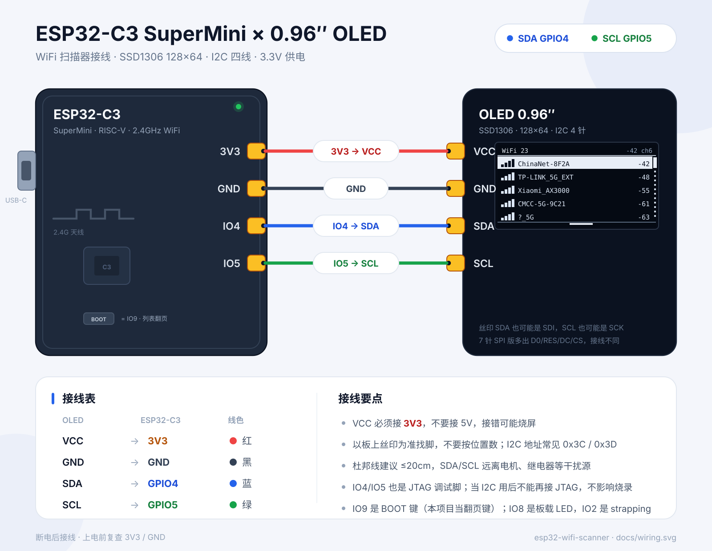
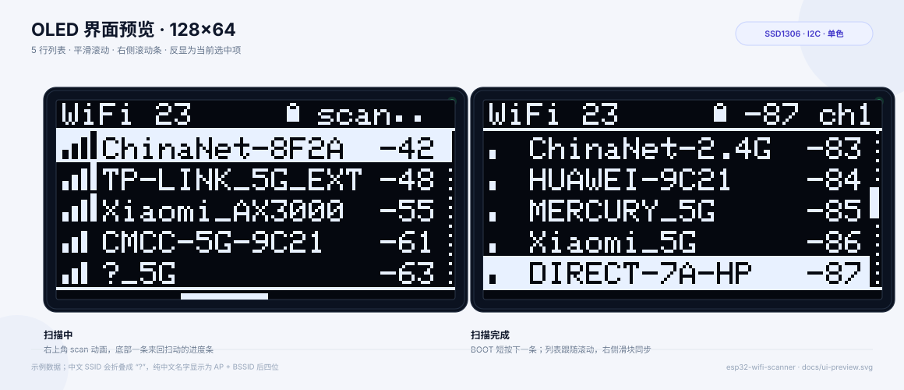

# ESP32-C3 SuperMini · OLED WiFi 扫描器

一块 **ESP32-C3 SuperMini** + 一块 **0.96″ SSD1306 OLED（128×64，I2C 四线）** 做的 2.4G WiFi 扫描器。异步扫描、按信号排序、5 行列表、平滑滚动、右侧滚动条，板载 BOOT 键就能操作。





## 功能

- 异步扫描附近 2.4G 热点，扫描时列表和动画不卡
- 按 RSSI 从强到弱排序，最多保留 40 个
- 5 行列表：信号格 + SSID + RSSI，当前选中行反显
- 平滑滚动动画 + 右侧滚动条（点线轨道 + 滑块）
- 顶栏显示热点数量、扫描动画、选中项的 RSSI / 信道 / 加密锁
- 底部扫描进度条来回扫动
- BOOT 短按切下一条，长按立即重扫；空闲 15 秒自动重扫
- 重扫后按 BSSID 尽量保持原来的选中项
- 自动探测 OLED 地址（0x3C / 0x3D），串口打印扫描结果

## 硬件

| 元件 | 说明 |
| --- | --- |
| ESP32-C3 SuperMini | RISC-V，2.4GHz WiFi，板载 USB-C（原生 USB） |
| OLED 0.96″ | SSD1306，128×64，**I2C 4 针版** |
| 杜邦线 | 4 根，建议 ≤ 20cm |

> 7 针的 SPI 版 OLED 不适用；买的时候认准 4 针 I2C（GND / VCC / SCL / SDA）。

## 接线

| OLED | ESP32-C3 | 线色 | 说明 |
| --- | --- | --- | --- |
| VCC | **3V3** | 红 | 一定接 3V3，不要接 5V |
| GND | **GND** | 黑 | 共地 |
| SDA | **GPIO4** | 蓝 | I2C 数据 |
| SCL | **GPIO5** | 绿 | I2C 时钟 |

注意事项：

- 以模块丝印为准找脚，不要数位置；丝印 `SDA` 也可能是 `SDI`，`SCL` 也可能是 `SCK`。
- I2C 地址一般是 `0x3C`，少数模块是 `0x3D`，固件会自动探测并打印到串口。
- GPIO4 / GPIO5 同时是 C3 的 JTAG 脚，用作 I2C 后不能再接 JTAG 调试，但不影响运行和烧录。
- 别占用 GPIO8（板载 LED）、GPIO2（strapping）、GPIO18/19（USB）、GPIO20/21（串口）；GPIO9 是 BOOT 键，本项目用它翻页。
- 杜邦线尽量短，SDA/SCL 远离电机、继电器等干扰源。

## 快速开始

需要 [PlatformIO](https://platformio.org/)（CLI 或 VSCode 插件都行）。

```bash
cd firmware

pio run                 # 编译
pio run -t upload       # 烧录
pio device monitor      # 串口 115200
```

打开串口后正常会看到：

```text
[oled] found at 0x3C
ESP32-C3 WiFi scanner
BOOT 短按=下一条 / 长按=重扫
[scan] 23 APs, top: ChinaNet-8F2A -42 dBm
```

VSCode 里也可以直接打开 `firmware/`，点底部状态栏的 **Upload** 和 **Monitor**。

### 烧录失败怎么办

1. 换一根**能传数据**的 USB-C 线（很多线只能充电）。
2. 按住板载 **BOOT** 不放，点一下 **RST**，松开 BOOT，再执行 `pio run -t upload`。
3. 还不行就把 `platformio.ini` 里的 `upload_speed` 降到 `115200`。

## 操作

| 操作 | 效果 |
| --- | --- |
| BOOT 短按 | 选中下一条；到末尾回到第一条，列表自动滚动 |
| BOOT 长按 0.7s | 立即重新扫描 |
| 空闲 15s | 自动重扫；选中项尽量保持不变 |

## 界面说明

```text
┌────────────────────────────────┐
│ WiFi 23        🔒   -63 ch1    │  顶栏：数量 / 加密锁 / 选中项 RSSI+信道
├────────────────────────────────┤
│ ▂▄▆█ ChinaNet-8F2A       -42   │  反显 = 当前选中
│ ▂▄▆█ TP-LINK_5G_EXT      -48   │
│ ▂▄▆  Xiaomi_AX3000       -55   │  5 行，10px/行
│ ▂▄▆  CMCC-5G-9C21        -61   │
│ ▂▄   ?_5G                -63  █│  右侧滚动条
├────────────────────────────────┤
│ ▬▬▬                            │  扫描时来回扫动
└────────────────────────────────┘
```

- 扫描中，顶栏右侧显示 `scan` 动画，底部出现扫动条。
- 扫描完成后，顶栏显示当前选中项的 RSSI 和信道。`ch` 是信道。
- 滚动条只在热点数超过 5 个时出现；轨道是点线，滑块是 3px 实心条。

## 目录结构

```text
esp32-wifi-scanner/
├── firmware/
│   ├── platformio.ini
│   └── src/
│       ├── config.h        # 引脚、扫描间隔、最大热点数
│       └── main.cpp        # 扫描 + 列表 UI + 按键 + 动画
├── docs/
│   ├── wiring.svg          # 接线图
│   └── ui-preview.svg      # 界面预览（用真实字库渲染）
├── tools/
│   └── render_preview.py   # 重新生成界面预览
└── README.md
```

## 可调参数

都在 `firmware/src/config.h`：

| 宏 | 默认 | 作用 |
| --- | --- | --- |
| `I2C_SDA_PIN` | 4 | OLED SDA |
| `I2C_SCL_PIN` | 5 | OLED SCL |
| `OLED_I2C_ADDR` | 0x3C | 首选地址，失败自动试 0x3D |
| `BTN_PIN` | 9 | 板载 BOOT |
| `BTN_LONG_MS` | 700 | 长按判定时间 |
| `MAX_APS` | 40 | 最多保留的热点数量 |
| `SCAN_INTERVAL_MS` | 15000 | 自动重扫间隔 |
| `SCAN_TIMEOUT_MS` | 20000 | 单次扫描超时保护 |

想换成 1.3″ 的 SSD1306 128×64（注意有些 1.3″ 是 SH1106，需要换驱动），只要还是 128×64，改引脚和地址即可；如果是 128×32，需要把 `SCREEN_H` 和布局常量一起调。

## 实现要点

- **异步扫描**：`WiFi.scanNetworks(true)` 发起后台扫描，主循环用 `WiFi.scanComplete()` 轮询，扫描期间动画和按键都不阻塞。
- **排序**：拿到结果后按 RSSI 插入排序，取前 `MAX_APS` 个。
- **平滑滚动**：`gScrollPx` 以 60ms 时间常数逼近目标行号，绘制时按像素偏移算行位置。
- **裁剪**：Adafruit GFX 没有裁剪矩形，列表行先画，再用标题栏和底部条覆盖溢出的部分。
- **保持选中**：重扫前记下选中项的 BSSID，重扫后在新列表里按 BSSID 找回来。
- **中文 SSID**：内置 5×7 字库只有 ASCII，连续非 ASCII 字符会折叠成一个 `?`；纯中文名字退化成 `AP xxxx`（BSSID 后四位），至少能区分。需要完整中文可以换 U8g2 的 `wqy12` 点阵字库（会多占约 100+ KB Flash）。

## 常见问题

**屏幕全黑，串口也没有 `[oled] found`**

检查 SDA 是否接 GPIO4、SCL 是否接 GPIO5、VCC 是否 3V3、GND 是否共地；有些模块丝印顺序是 `GND VCC SCL SDA`，别按位置插。地址不对时固件会自动试 `0x3D`。

**串口监视器没有输出**

确认用的是板子上的 USB-C 口、线能传数据；`platformio.ini` 已经打开 `ARDUINO_USB_MODE=1` 和 `ARDUINO_USB_CDC_ON_BOOT=1`，监视器波特率 115200。

**列表里没有我家 5G WiFi**

ESP32-C3 只支持 2.4GHz，5GHz 热点不会出现。

**中文 SSID 显示成 `?`**

见上面的“实现要点”。这是 5×7 ASCII 字库的限制，不是乱码。

**刷新有点慢 / 滚动不够丝滑**

I2C 已跑在 400kHz，128×64 整帧 1KB，扫描动画时大约 20–25fps 是正常的。可以把 `display.display()` 的频率再降一点，或把扫描间隔调大。

**热点太多，列表太长**

把 `MAX_APS` 调小（比如 20），或者扫描时只保留信号强的前 N 个（代码里已经按 RSSI 排序，直接截断即可）。

## 重新生成界面预览

预览图是用**真实的 Adafruit 5×7 字库**逐像素渲染的，不是手画的：

```bash
# 先编译一次，让 PlatformIO 下载 Adafruit GFX
cd firmware && pio run
cd ..
python3 tools/render_preview.py
```

会重新生成 `docs/ui-preview.svg`。
