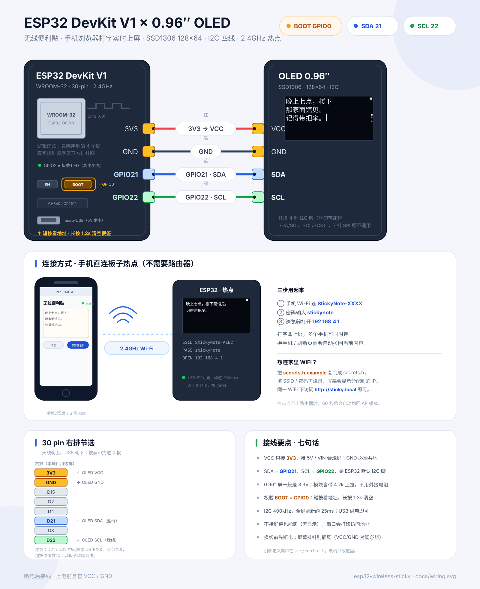

# ESP32 · 无线便利贴（手机打字 → OLED 实时上屏）

一块 **ESP32 DevKit V1** + 一块 **0.96″ SSD1306 OLED（128×64，I2C）**，把手机浏览器变成这块小屏幕的键盘。

板子自己开热点，手机连上后打开网页，**每敲一个字，桌上那块屏就同步变一次**；不用装 App、不用路由器、不用数据线。断电再上电，最后一张便签还在。



## 它是什么

- **手机 → OLED 实时同步**：WebSocket 双向通道，打字延迟约 70ms，屏幕上还有闪烁光标。
- **两种网络模式**：默认自己开热点（走到哪用到哪）；也可以填 `secrets.h` 连家里 WiFi，用 `http://sticky.local` 访问。
- **中文 + 英文**：正文用 U8g2 的 GB2312 字库（`wqy12_t_gb2312`），一屏 5 行，超出自动翻页。
- **网页端即时预览**：页面里有一块 128×64 的 canvas，近似还原 OLED 排版，打字时不用一直扭头看板子。
- **断电不丢**：内容写进 NVS，停止输入 1.5 秒后落盘，不折腾 Flash。
- **两个实体操作**：板载 BOOT 短按看连接信息，长按 1.2 秒清空便签。
- **没有屏幕也能跑**：I2C 扫不到 OLED 时固件照常启动，串口打印访问地址。

## 硬件

| 元件 | 说明 |
| --- | --- |
| ESP32 DevKit V1 | WROOM-32，30 pin，micro-USB + CH340 / CP2102 |
| OLED 0.96″ | SSD1306，128×64，**4 针 I2C 版** |
| 杜邦线 | 4 根，建议 ≤ 20cm（400kHz I2C 对线长敏感） |
| USB 线 / 充电头 | 能传数据的那种；调试时接电脑，日常用 5V 充电头即可 |

> 7 针 SPI 版 OLED 不适用。买的时候认准 4 针、丝印是 `GND / VCC / SCL / SDA`（`SDI` = SDA，`SCK` = SCL）。
> 模块一般自带 4.7k 上拉电阻和 3.3V 稳压，直接接 ESP32 的 3V3 即可。

## 接线

| OLED | ESP32 DevKit V1 | 线色 | 说明 |
| --- | --- | --- | --- |
| VCC | **3V3** | 红 | 右排最上面那根；**不要接 5V / VIN** |
| GND | **GND** | 黑 | 右排第二根，必须共地 |
| SDA | **GPIO21** | 蓝 | ESP32 默认 I2C 数据 |
| SCL | **GPIO22** | 绿 | ESP32 默认 I2C 时钟 |
| — | **BOOT（GPIO0）** | — | 板载按键，不用接线 |

> DevKit V1 上 GPIO21 和 GPIO22 **不是相邻的两根**，中间隔着 RX0(3) / TX0(1)，按丝印找。
> OLED 地址一般是 `0x3C`，少数模块是 `0x3D`；固件两个都试，串口会打印实际地址。

接线图里还画了 30 pin 右排节选、手机热点连接示意和七条接线要点，可以直接照着插。

## 快速开始

需要 [PlatformIO](https://platformio.org/)（CLI 或 VSCode 插件都行）：

```bash
cd firmware
pio run                 # 编译
pio run -t upload       # 烧录
pio device monitor      # 串口 115200
```

> 首次烧录如果报 `Failed to connect`：按住板载 **BOOT**，点一下 **EN**，松开 BOOT 再上传。

正常上电的串口大概是这样：

```text
=== Wireless Sticky ===
[oled] 0x3C ok
[wifi] AP "StickyNote-A1B2" pass=stickynote ip=192.168.4.1
[web] http://192.168.4.1/  mode=ap
[note] restored 42 bytes
[web] open http://192.168.4.1/ in your phone browser
BOOT: short press = connection info, long press = clear note
```

烧录完成后：

1. 手机 Wi-Fi 连 **`StickyNote-XXXX`**（XXXX 是 MAC 末两字节，每块板子不同）。
2. 密码 **`stickynote`**。
3. 浏览器打开 **`http://192.168.4.1`**。
4. 在便签框里打字，OLED 立刻同步。

> Android 提示「此网络无法访问互联网」时，选择「保持连接 / 仍然使用」即可；这是热点没有外网导致的正常提示。

## 两种网络模式

### 默认：自己开热点（AP）

- SSID：`StickyNote-XXXX`，密码 `stickynote`，地址固定 `192.168.4.1`。
- 最多 4 台设备同时连，多个手机可以一起编辑（后写覆盖先写，所有人立刻看到结果）。
- 开了 DNS 劫持 + `onNotFound` 跳转，不少手机会自动弹出「登录网络」页面；没弹出就手动打开地址。
- 不需要路由器，也不需要外网，露营、摆摊、教室里都能用。

### 可选：连家里 WiFi（STA）

把 `firmware/src/secrets.h.example` 复制成 `firmware/src/secrets.h`，填上 SSID / 密码：

```cpp
#define WIFI_SSID "your-wifi-name"
#define WIFI_PASS "your-wifi-password"
```

重新烧录后：

- 开机先尝试连接，**15 秒**连不上就自动改开热点（不会变成一块砖）。
- 连上后屏幕显示分配到的 IP，同一 WiFi 下访问 `http://sticky.local` 或这个 IP。
- 运行中掉线超过 **60 秒**，会自动关掉 STA、切回 AP 模式，并把新地址显示在屏幕上。
- `secrets.h` 已在 `.gitignore` 里，不会被提交。

## 网页界面

页面是单文件内嵌在固件里的（`web_ui.h`，PROGMEM），不依赖任何 CDN：

| 区域 | 作用 |
| --- | --- |
| 便签纸 | 主输入框，最多 200 字；停止输入 70ms 后通过 WebSocket 发出 |
| 状态胶囊 | `已连接 / 重连中`，断线自动指数退避重连（1s → 8s） |
| OLED 预览 | canvas 按 128×64 近似排版，含翻页点、在线点和光标 |
| 插入时间 | 插入 `2026-10-28 20:15` 这样的时间戳 |
| 清空 | 按钮变红后再点一次确认，清空屏幕和所有已连接设备（不用系统弹窗，手机浏览器拦截弹窗也照样能用） |
| 设备状态 | 访问地址、网络模式（AP / STA）、在线设备数 |

几个细节：

- 断线期间继续打字会标记为「离线编辑」；重连后以本地内容为准推回板子，不会被旧内容覆盖。
- 中文输入法还在选拼音时不会把半成品发上屏，选完词才同步；输入过程中也不会改动输入框高度，避免手机键盘被顶掉。
- 别的设备改了内容，本页会同步更新，同时尽量保留光标位置。
- 页面带 `Cache-Control: no-store`，改完固件刷新就能看到新版本，不会吃到旧缓存。

## BOOT 键

| 操作 | 效果 |
| --- | --- |
| 短按（≥ 60ms） | 显示连接信息页 5 秒：AP 名称 / 密码 / 地址，或 STA 的 IP |
| 长按 1.2 秒 | 清空便签，屏幕弹「已清空」 |
| 按住 BOOT 再点 EN | 进入下载模式（ESP32 本身的设计，不是 bug） |

连接信息页长这样（AP 模式）：

```text
        WIRELESS STICKY
   AP   StickyNote-A1B2
   PASS stickynote
   OPEN 192.168.4.1
      连上热点，打开地址
```

## 屏幕上显示什么

- 正文：`u8g2_font_wqy12_t_gb2312`，12px 高，5 行 × 120px，约 **10 个汉字 / 20 个半角字符每行**。
- 自动折行：按 UTF-8 字符推进，不会把汉字切一半；`\n` 强制换行。
- 自动翻页：超过 5 行时每 **3.2 秒**翻一页；正在打字时先停在最后一页 **2.4 秒**，停手后才从头轮播。
- 光标：有手机连着时，最后一页末尾有 **530ms** 周期闪烁的竖线。
- 状态点：右上角实心 = 有设备连接，空心 = 没有。
- 翻页点：右侧小点表示当前第几页。
- 空便签：显示「无线便利贴 / 手机浏览器打开 / http://IP」。

GB2312 字库覆盖常用简体字和 ASCII；**emoji、生僻字、繁体字可能显示为空白**，这是字库取舍，不是乱码。

## 数据与持久化

- 正文上限 **600 UTF-8 字节**，约 200 个汉字；网页输入框限制 200 字符。
- 保存前会去掉 `\r` 和其它控制字符，`\t` 换成两个空格，并按 UTF-8 边界截断，不会写坏半个汉字。
- 停止输入 **1.5 秒**后写一次 NVS（`sticky/note`），避免每敲一个字就擦写 Flash。
- 断电、复位、重新烧录都不丢；`pio run -t erase` 或长按 BOOT 才会清空。
- 所有读写都经过互斥锁，异步 Web 任务不会读到「半个字符」。

## WebSocket 协议

地址：`ws://<IP>/ws`，文本帧，第一个字符是命令。

**板子 → 手机**

| 消息 | 含义 |
| --- | --- |
| `T<text>` | 当前完整便签（连接时、内容变化时） |
| `S<json>` | 设备状态，如 `{"mode":"ap","ip":"192.168.4.1","ssid":"StickyNote-A1B2","clients":1,"bytes":42,"max":600}` |
| `N<count>` | 在线设备数变化 |

**手机 → 板子**

| 消息 | 含义 |
| --- | --- |
| `T<text>` | 整体替换便签（不是增量，天然幂等） |
| `C` | 清空 |

设计上刻意用「整体替换」而不是「按键事件」：断线重连、多端同时编辑、页面刷新都只需要对齐最后一份完整文本。

## HTTP 接口

| 方法 | 路径 | 说明 |
| --- | --- | --- |
| GET | `/` | 内嵌网页 |
| GET | `/api/note` | 纯文本便签，`text/plain; charset=utf-8` |
| POST | `/api/note` | 用原始 body 替换便签 |
| GET | `/api/status` | 设备状态 JSON |
| POST | `/api/clear` | 清空 |
| GET | `/favicon.svg` | 内嵌图标 |

用 curl 从电脑推一段文字（注意 `Content-Type` 要是 `application/octet-stream`，否则会被当成表单解析）：

```bash
curl -X POST "http://192.168.4.1/api/note" \
     -H "Content-Type: application/octet-stream" \
     --data-binary "今晚七点，老地方见"
```

读取和清空：

```bash
curl http://192.168.4.1/api/note
curl -X POST http://192.168.4.1/api/clear
```

## 代码结构

```text
esp32-wireless-sticky/
├── README.md
├── docs/
│   └── wiring.svg          # 接线图 + 热点连接示意 + 30 pin 排针
└── firmware/
    ├── platformio.ini      # 板型、分区表、库版本、UTF-8 编译参数
    └── src/
        ├── main.cpp        # 启动流程、网络切换、BOOT 键、主循环
        ├── config.h        # 所有引脚 / 网络 / 排版参数
        ├── note.h/.cpp     # 线程安全正文仓库 + NVS 防抖持久化
        ├── display.h/.cpp  # U8g2 排版、折行、翻页、光标、开机页
        ├── web.h/.cpp      # AsyncWebServer + WebSocket +  captive DNS
        ├── web_ui.h        # 内嵌网页（HTML/CSS/JS/canvas）
        └── secrets.h.example
```

### 三个关键设计

**1. 只有一份正文，所有修改都走 `note::set()`**

AsyncWebServer 的回调跑在 AsyncTCP 任务里，`loop()` 跑在 Arduino 任务里。两边都可能读写正文，所以 `note.cpp` 用互斥锁包住 `String`，对外只暴露「整体替换 / 取快照 / 取版本号」，不做增量拼接，避免读到半个 UTF-8 字符。

**2. 异步回调不碰 I2C**

WebSocket 回调只改 `note`，不直接画屏、不直接广播。`loop()` 里用 `note::takeChange()` 取到新版本后，统一做两件事：

```cpp
if (note::takeChange(content)) {
  display::setNote(content);   // 重排 + 标脏
  web::broadcastNote(content); // 群发所有手机
}
```

这样 I2C 和 WebSocket 发送都在主循环里串行执行，不会出现两个任务同时推总线。

**3. 显示按「脏标记」刷新**

`display::tick()` 只在内容变化、翻页、光标翻转、提示出现时重画，并通过 `sendBuffer()` 推一整屏（1KB，400kHz 下约 25ms）。没有变化时 loop 只是空转，不会持续占用 I2C。

## 可调参数

都在 `firmware/src/config.h`：

| 宏 | 默认值 | 作用 |
| --- | --- | --- |
| `I2C_SDA_PIN` / `I2C_SCL_PIN` | `21` / `22` | OLED 数据 / 时钟脚 |
| `I2C_CLOCK_HZ` | `400000` | I2C 频率，线长时可降到 100000 |
| `OLED_I2C_ADDR` | `0x3C` | 首选地址，失败会自动试 `0x3D` |
| `AP_SSID_PREFIX` | `"StickyNote-"` | 热点名前缀 |
| `AP_PASSWORD` | `"stickynote"` | 热点密码（至少 8 位） |
| `AP_CHANNEL` | `6` | 热点信道 |
| `AP_MAX_CLIENTS` | `4` | 最多同时连接数 |
| `WIFI_CONNECT_TIMEOUT_MS` | `15000` | STA 连接超时，之后改开热点 |
| `MDNS_HOST` | `"sticky"` | 局域网地址 `sticky.local` |
| `MAX_NOTE_BYTES` | `600` | 正文 UTF-8 字节上限 |
| `SAVE_DEBOUNCE_MS` | `1500` | 停止输入多久后写 NVS |
| `TEXT_W` | `120` | 正文最大像素宽度 |
| `PAGE_LINES` | `5` | 一屏行数 |
| `PAGE_MS` | `3200` | 多页时每页停留时间 |
| `TYPE_HOLD_MS` | `2400` | 打字时停在最后一页的时间 |
| `CARET_BLINK_MS` | `530` | 光标闪烁半周期 |
| `SPLASH_MS` | `5000` | 开机信息页停留时间 |
| `BTN_SHORT_MS` | `60` | 短按判定 |
| `BTN_CLEAR_MS` | `1200` | 长按清空判定 |

> `U8g2` 的 GB2312 字库约 200KB，本固件已经到 1.02MB，默认 1.25MB app 分区余量太小，所以 `platformio.ini` 用了 `huge_app.csv`（3MB app / 1MB SPIFFS），以后加 OTA 或网页资源也不用重新分区。当前 Flash 占用 33.9%，RAM 14.5%。

## 常见问题

**屏幕全黑 / 只有背光**

先看串口有没有 `[oled] 0x3C ok`。没有的话依次检查：VCC 是否接在 3V3（不是 5V）、GND 是否共地、SDA/SCL 是否接反、模块是不是 4 针 I2C 版。固件会自动扫 `0x3C` 和 `0x3D`，扫不到也会继续跑网页服务。

**烧录成功但屏幕黑、也搜不到热点**

先按一下板子上的 **EN**（不是 BOOT）复位，等 5–10 秒；有些 CH340 板子上传完不会自动重启。然后确认 BOOT 键没有被卡住（按住 BOOT 上电会进下载模式，固件不会运行）。串口 115200 应该能看到 `=== Wireless Sticky ===` 和 `[wifi] AP "StickyNote-XXXX"`。热点名是实际后缀（如 `StickyNote-438C`），不是字面量 `XXXX`。

**屏幕全黑但串口显示 `[oled] 0x3C ok`**

说明 I2C 总线和供电正常，问题在显示驱动。本项目用的是 SSD1306；如果模块实际是 SH1106，需要把 `display.cpp` 里的构造函数换成 `U8G2_SH1106_128X64_NONAME_F_HW_I2C`。另外确认 VCC 接的是 3V3，不是 5V / VIN。

**手机搜不到热点**

ESP32 只支持 **2.4GHz**；确认板子已经上电、串口打印了 `AP "StickyNote-XXXX"`。如果填了 `secrets.h`，开机会先花最多 15 秒尝试连家里 WiFi，这段时间热点还没起来，等一下再看。

**连上热点但网页打不开**

手动在浏览器输入 `http://192.168.4.1`（要带 `http://`，不要用搜索框）。Android 的「此 WiFi 无法访问互联网」提示选择保持连接；iPhone 可能需要等几秒让 Captive Portal 弹出，或直接手动访问。

**中文显示空白 / 方块**

正文只带 GB2312 常用字库，emoji、生僻字、繁体字没有字形。换成常用简体字即可。乱码（比如半个汉字）不会出现，固件按 UTF-8 边界截断。

**打字有延迟 / 偶尔跳字**

网页端有 70ms 合并发送，属于正常现象。延迟明显时看信号强度、把手机靠近板子；多个设备同时输入时是「后写覆盖先写」，不会合并两段文字。

**局域网模式 IP 变了**

用 `http://sticky.local`（mDNS），或短按 BOOT 看当前 IP，也可以看串口日志。路由器给板子重新分配 IP 是正常的，建议在路由器里做静态租约。

**上传失败 / 找不到串口**

装 CH340 或 CP2102 驱动；换一根能传数据的 USB 线；按住 BOOT、点 EN、松开 BOOT 再上传。烧录波特率已设成 460800，线差时可以降到 115200。

**想彻底清空**

长按 BOOT 1.2 秒，或 `pio run -t erase` 擦掉整个 Flash（会连 WiFi 配置一起清）。

## 可以继续玩

- 加一个「历史便签」轮播：NVS 里存最近 5 条，短按 BOOT 切换。
- 加番茄钟 / 倒计时：网页设时间，OLED 显示剩余分钟，到点闪屏。
- 加亮度调节：网页滑杆 → `u8g2_SetContrast()`，夜里不刺眼。
- 换成 1.3″ SH1106 或 2.42″ SSD1309，只改 U8g2 构造函数和 `SCREEN_W/H`。
- 加 OTA：`ArduinoOTA` + 网页上传固件，不用每次插线。

## 许可

代码随意取用；接线图和 README 同样可以随意改。烧录前记得先断电接线，复查 VCC / GND。
